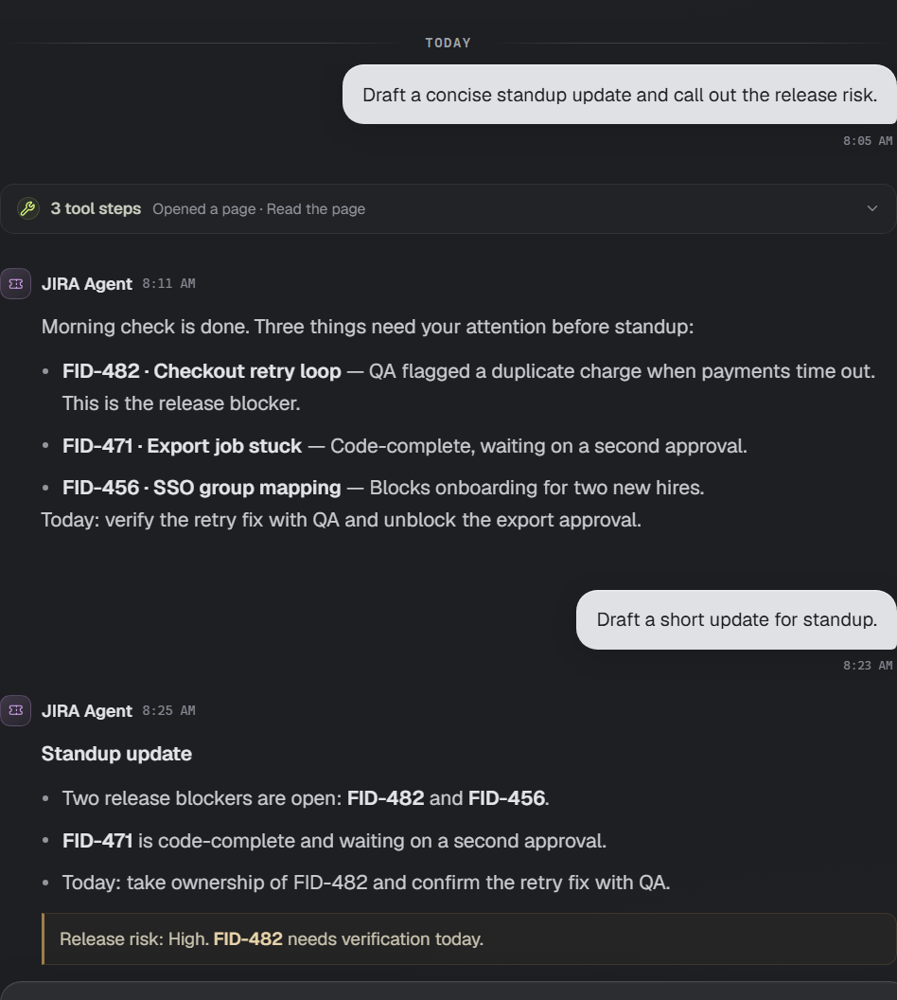
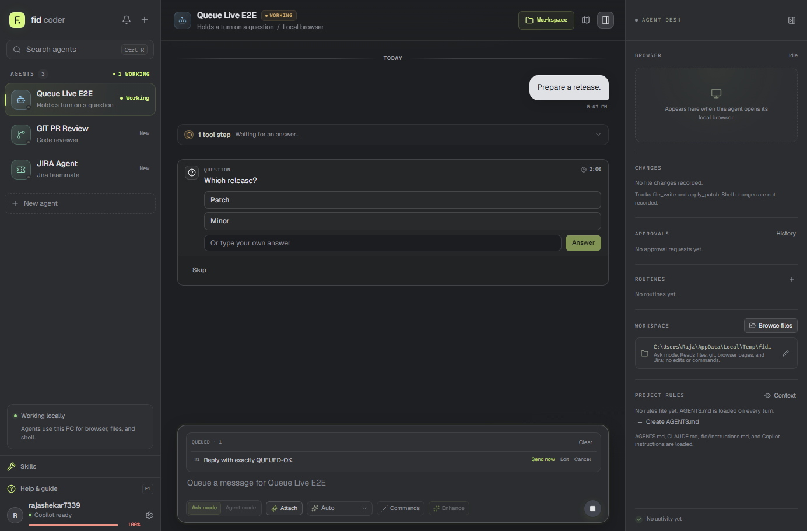
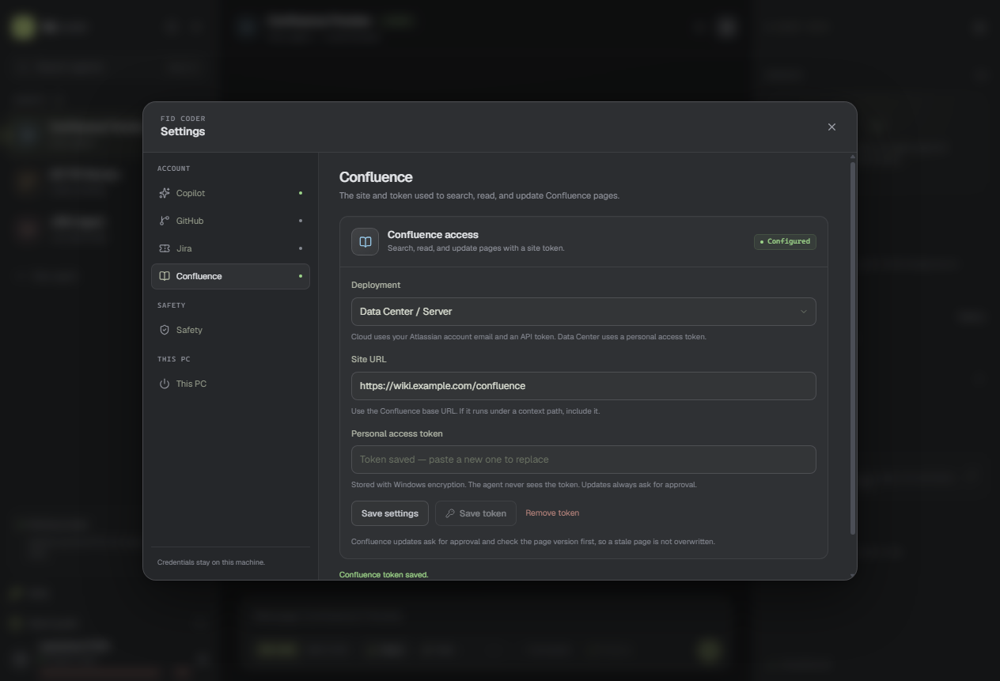
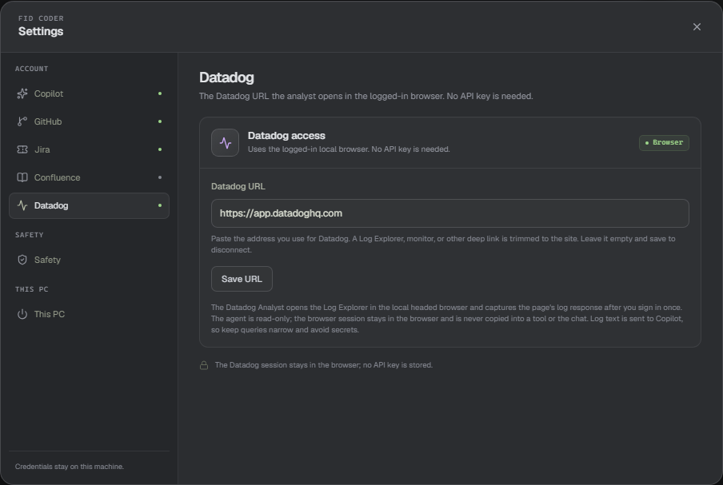
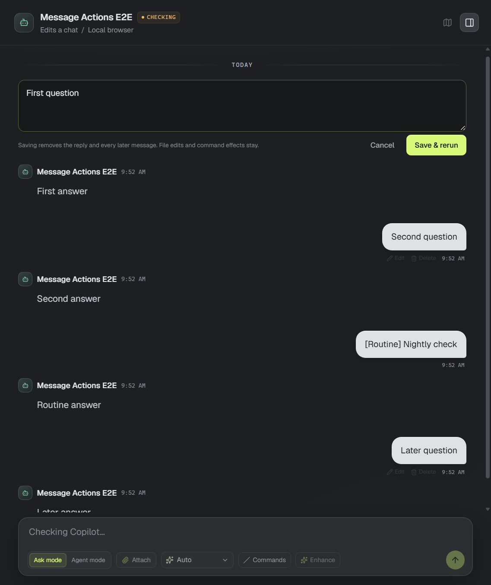
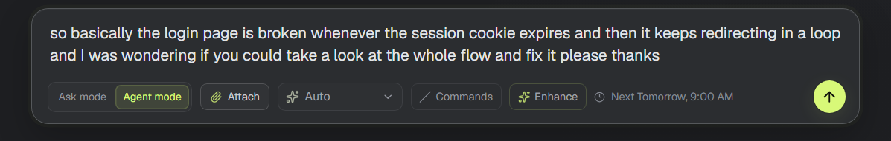
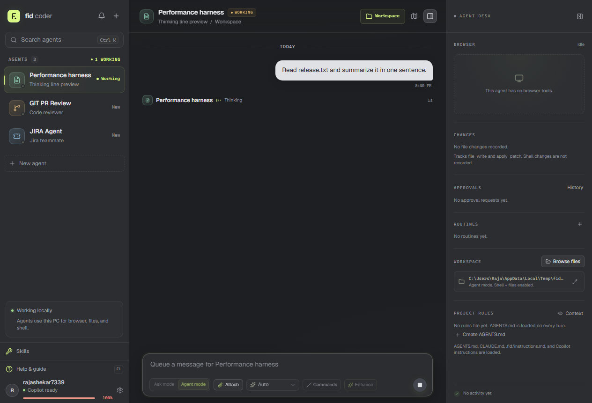
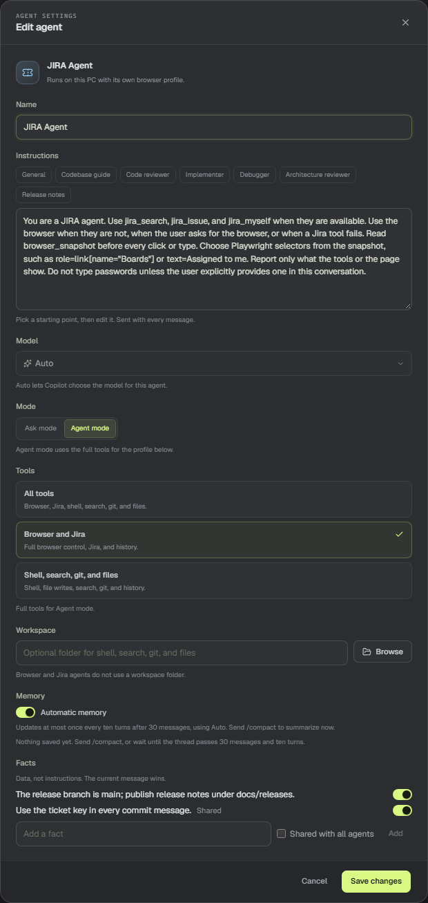
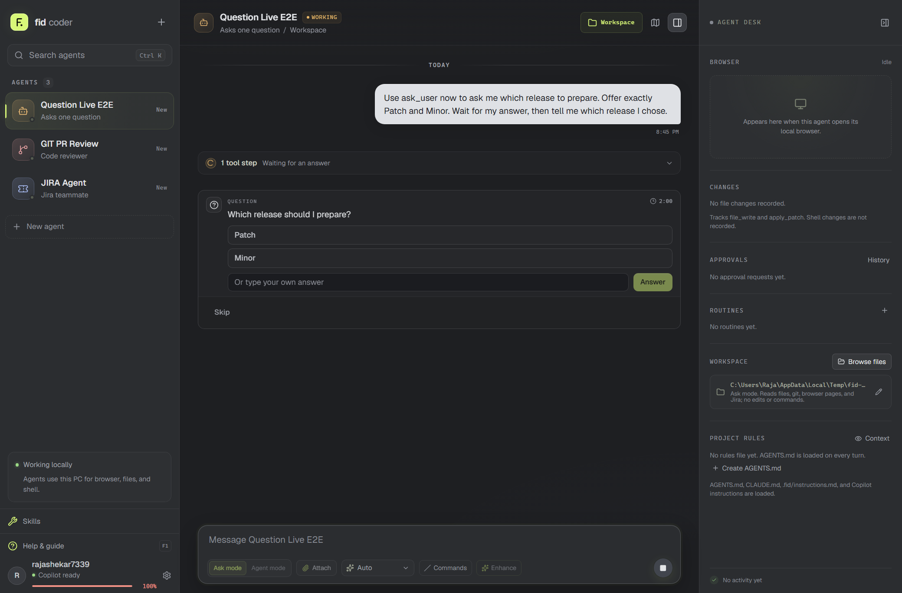
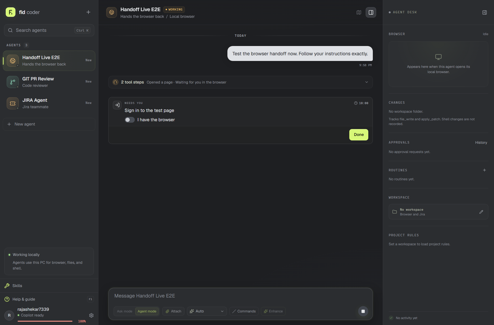

# Chat with an agent

The conversation is the center column. Messages stream in as the agent works, tool calls are grouped into one card, and every reply is saved locally with the agent.

## Send a message

Type in the composer and press **Enter**. Use **Shift+Enter** for a new line. The composer grows up to eight lines.

The agent can only answer after Copilot is connected. If the composer says "Sign in to Copilot to chat", open **Settings → Copilot** and sign in.

## Queue a follow-up

While a turn is running, the composer stays open. Type a follow-up and press **Enter** to queue it. Queued messages appear above the composer in order. Each row shows **Send now**, **Edit**, and **Cancel**.

- **Send now** stops the current turn and starts that message immediately. It does not inject the message into the running turn.
- **Edit** opens the queued text in place. **Enter** saves, **Shift+Enter** adds a line, and **Escape** closes the editor.
- **Cancel** removes the message from the queue.
- With text in the composer, **Ctrl+Enter** (or **Cmd+Enter** on a Mac) also sends now and stops the current turn. While a turn is running, the composer shows only **Stop**; press **Enter** to queue the draft, then use **Send now** on its row when you want it to start immediately.

A queued message is not saved until it starts. When a turn finishes normally, the next queued message starts automatically. If you press **Stop** or the turn fails, the queue pauses: choose **Send next** or **Clear**, or send another message. The queue is kept for the current app session; closing Fid Coder clears it. Attachments can be queued too. The queue holds up to 20 messages.

## Attach files and code

Use the paperclip button in the composer to attach local files. When the agent has a workspace and file tools, a text or code file is copied to `.fid/uploads/` in the workspace and the agent is given its path; it reads the file with its normal file tools. Without a workspace, a text-like upload such as CSV, TSV, TXT, Markdown, JSON, or code is sent to the model as attached text, up to 200,000 characters. Binary files such as XLSX, PDF, or ZIP still need a workspace folder and file tools. PNG, JPEG, WebP, and GIF images are sent to the model as images, capped at 10 MB, for any agent. A Browser & Jira agent can receive a supported image or a text-like upload; it cannot read workspace paths. Remove a chip with its **×** before sending. If the draft is empty, the message is sent as "Review the attached content."

To point at code, open the Workspace panel. The file you are viewing is automatically the active context for your next message, and the last file you visit wins. Click a line number and shift-click or drag down the gutter to narrow it to a range; the composer shows an active chip such as `runner.ts:420–440`. Press **Ctrl+Shift+L** or use the chip's pin action to keep that file or range, then move to another file and pin it too. Pinned chips are sent together; the agent decides which context to use. Escape clears a selection, and the chip's **×** clears the active file.

Attachments use the model's attachment support. An image needs a model that accepts images. The chips stay under the user message after the turn is saved.

Text and code attachments are not sent as binary context. When the agent has a workspace and file tools, the app copies the file into the workspace and puts its path at the top of the message, so the agent can read it with the same tools it uses for the repository. Without a workspace, the text is sent in the message as attached text instead. This follows Code Puppy's approach: the app passes the file, and the agent decides what to do with it.

## Read a spreadsheet

Ask the agent to read a CSV or Excel file in the workspace. `table_read` handles `.csv`, `.tsv`, `.xlsx`, and `.xlsm`. It shows the sheet names, the headers, and a preview; say **next rows** or name a row range to page through a large sheet. A sheet can be chosen by name.

The preview is bounded: 50 rows by default, 200 maximum, with long cells shortened. That keeps a large workbook from filling the conversation. Excel formulas are not calculated — the reader returns the last saved value where one exists — and macros are never run. Files above 20 MB, `.xls`, and `.ods` are refused; save the file as `.xlsx` or `.csv` first. If you attach a CSV to an agent without a workspace, the file is sent as attached text instead; `table_read` and its paging need a workspace folder.

## Read and update Confluence

With **Settings → Confluence** saved, paste a page link and ask the agent to read it. It passes the URL to `confluence_page`, which resolves common Cloud and Data Center links and short `/x/` links. It can also search with CQL, such as `space = ENG AND text ~ "release notes"`, or read by id or space and title. The tools work in Ask mode too, so a read-only agent can answer from Confluence.

Ask it to append a note or replace a section. The agent reads the page first and passes the current version, so a page someone else changed meanwhile is refused instead of overwritten. The normal approval card appears before the write; **Reject** leaves the page untouched. An append keeps the existing page body. A Markdown replace is refused when the page contains Confluence macros, because the conversion would drop them; use append or storage format for those pages. `confluence_update_page` is not available in Ask mode or to a routine.

## Troubleshoot with Datadog

Open the **Datadog Analyst** and describe the symptom, such as “checkout-api is returning 500s for some orders in the last 30 minutes. What changed?” No Datadog API key is required. The agent opens the logged-in Log Explorer in the local headed browser, captures the page's JSON log response, and returns compact rows. If Datadog asks for a sign-in, the **Needs you** card appears; sign in once in the visible browser and choose **Done**. The browser profile keeps the login.

The agent loads its triage skill, finds the errors by service and error type, samples the logs, and checks the deploy and alert context. Then it maps the stack to the workspace, reads the failing function and its callers, checks recent commits, and reports the root cause with `path:line` evidence, a confidence level, and a verification query.

Browser results are a page sample, not the full index; the agent labels them that way.

Attach a workspace folder to get the root-cause step. Without one, the agent stops at the telemetry evidence and asks for the repository. The Datadog tools are read-only; the agent cannot change a monitor, dashboard, or setting. It also has no shell or file-write tools, so a misleading log line cannot turn into a code change.

Save your Datadog URL in **Settings → Datadog**, such as `https://app.datadoghq.com`; the badge shows **Browser**. No API key is requested or stored. The session credential stays in the browser, and the agent never sees it.

Log text is sent to Copilot as tool output, so keep queries narrow and avoid searching for secrets. The first release can search logs by trace id, but it does not open the full APM trace, RUM sessions, incidents, or dashboards yet.

## Edit or delete a message

User messages from a normal chat turn show **Edit** and **Delete** beside their time. The actions are disabled while the agent is working; press **Stop**, then edit or delete. Routine messages, assistant replies, and tool steps are read-only.

**Edit** opens the message in place. **Save & rerun** removes the old reply and every later message, then sends the edited text as a new turn. The attachments stay with the message. **Cancel** closes the editor without changing anything.

**Delete** asks for confirmation. It removes that user message and the agent's reply, but keeps earlier and later messages; later messages may refer to the removed exchange. The actions are not undoable.

Neither action reverts files the agent already changed, undoes a created routine, or removes a saved skill. Those side effects stay. The agent's rolling summary is cleared, so it is rebuilt from the remaining messages on a later turn.

## Improve a draft

Choose **Enhance** next to **Commands** to rewrite the current draft. It makes the wording shorter and more specific, keeps paths, quotes, and slash commands, and uses the last few messages for context. Nothing is sent: the rewrite stays in the composer so you can edit it and send when ready. Choose **Undo** to restore the draft you had before the rewrite.

Enhance runs only when you choose it. It does not run on later messages and does not change what Send does. It uses Copilot quota and picks a cheap model when your account lists one. Composer commands and a running agent are skipped with a short reason; any other non-empty draft, including a short one, runs when you choose Enhance.

## Follow the work

While the agent runs, its current tool step is highlighted in the open tool card. Finished tool calls stay in the card above the reply. The card's line summarizes what the run did, such as **Read 2 files · Searched the code · Ran 1 command**, and counts any issues. Expand it to see each call, a short summary of its result, and **Failed** on a call that did not work.

Between steps, **Thinking** appears beside the agent name with animated bars and the elapsed time. There is no separate card. It disappears when the answer starts streaming, and it is not saved. The reply's foot shows how long the turn worked, such as **Worked for 2m**; a live turn says **Working for 12s**.

Day dividers mark **Today**, **Yesterday**, and older calendar dates. They stay at the top of the thread while you scroll that day. Hover any time to see the full date and timestamp.

The conversation is saved in the local SQLite database. When Fid Coder rebuilds a Copilot session, it sends the last 30 messages, or the summary plus the latest messages after a summary exists. That transcript is clipped to 12,000 characters. Send `/compact` to summarize before the automatic update.

## Use a command

Type `/` in the composer, or choose **Commands** next to the model picker, to open the command list.

- `/skills <skill-id> <task>` — load an installed skill for this message. Later messages keep a short used-skills list and can reload it.
- `/skills` — open the Skills library.
- `/review` — review uncommitted changes, staged changes, a branch, a PR number, or a path.
- `/compact` — summarize this conversation now. The next message keeps the summary and the latest messages.
- `/files` — open the workspace file browser. It is available only when the agent has a workspace folder.
- `/help` — open this guide.

Use ↑/↓ to move, Enter or Tab to select, and Escape to close. A command that needs a workspace or developer tools shows the reason in the list. The empty conversation also shows the available commands as chips.

The **Skills** row at the bottom of the sidebar opens the library. It lists every installed skill, its source, version, and size, and has the **Upload skill** button. Skills are global; nothing from a skill is added to an agent until you use `/skills`. After that, later messages get a short used-skills list and the assistant can reload the skill when it needs it.

## Compact the conversation

Send `/compact` when you want the conversation summarized now. Fid Coder uses the same Auto summary it builds after the thread passes 30 messages. The messages stay in the chat. The next message starts a fresh Copilot session that keeps the summary and only the latest messages.

`/compact` also runs when Automatic memory is off, and before the thread is long enough for an automatic update. It spends Copilot quota only when there is something new to summarize. If the summary is already current, the next message still starts from that summary. Send `/compact` on its own.

## Remember a fact

Open **Edit agent**. Under **Facts**, add a short line the agent should keep, such as the test command or the release branch. A fact is data. If it disagrees with the message you just sent, the message wins. Check **Shared with all agents** to store it for every agent. Turn a fact off to hide it without deleting it. **Forget**, then **Forget it**, removes it, and **Undo** puts that fact back. Facts save immediately and are separate from the agent form. The agent does not invent them, and a fact cannot hold a token or a key.

## Ask for a code review

A developer or all-tools agent has the **/review** command. Type `/review` and add `staged`, `branch <name>`, `pr <number>`, or a path. Leave the target empty to review the uncommitted changes. The review runs in a read-only session: it can read, search, and use git reads, but it cannot edit files, run shell commands, or control a browser. The report appears in the chat.

## Use the model picker

The model picker sits in the composer. **Auto** lets Copilot choose the model for the agent. The other choices are the models the signed-in Copilot session reports as selectable; if it reports none, only Auto is available. Choose another model when the agent is idle; the picker is disabled while a turn is running. The new model applies to the next reply. If Copilot cannot use the chosen model, the turn stops with an error instead of answering with a different model.

## See token and credit usage

Each assistant reply has a small usage line: the total tokens, the AI credits Copilot reported, and the model that produced that reply. Select it to see input, output, cache-read tokens, model calls, and a token-composition bar.

The model on this line is historical: it names the model that served that reply. Changing the picker does not rewrite earlier usage lines. When Copilot chose the model automatically, the line shows `Auto · <model>`.

AI credits appear when Copilot reports them for the model call. If the account or model does not report a credit cost, the credits value is hidden. A `~` means some model calls in the turn did not report a cost, so the amount is a subtotal.

> **Tip:** Cached tokens are part of input; they are not counted twice.

## Stop a turn

Press the square stop button while the agent is working. Any partial reply is kept in the conversation with a note that the turn stopped.

## Approve a command

The shell tool pauses before a delete, a git push, or a download. A compact approval card appears in the conversation with the command, working folder, and risk, plus an auto-deny countdown. Choose **Reject**, **Always deny**, **Always allow**, or **Allow once**. The same card is on the bell's **Needs you** list, grouped with that agent's other waiting items. Answering it in either place clears both.

**Always allow** and **Always deny** save a rule for that exact command and folder. Deny rules win over allow rules. Ending the turn or ignoring the countdown rejects the command. Every request and decision appears in the Agent Desk approvals history, and saved rules are under **Settings → Safety**.

## Answer a question

When the agent needs a preference it cannot look up, it asks one question in the conversation. The card lists two to four choices. Pick one, or type your own answer and choose **Answer**. **Skip**, or waiting about two minutes, lets the agent continue with no answer. It should not ask again in that turn.

Stopping the turn, or closing Fid Coder, closes the card. The card is not saved. Ask mode can ask too. A routine that creates another routine cannot, and a scheduled run that nobody answers continues after the countdown. If another agent is waiting, a bar at the top of the chat opens that agent.

## Hand the browser back

When a page needs you to sign in or solve a captcha, the agent shows a **Needs you** card. Turn on **I have the browser** to bring that agent's browser window forward. Sign in there. The agent cannot click, type, navigate, or read the page while the card is open. Choose **Done** when you are finished. It takes a fresh snapshot before the next click, type, or page change, and it does not ask you to paste a password into the chat.

The card waits about ten minutes. If the time runs out, the agent continues and still starts with a fresh snapshot. Stop closes the card. The card is not saved. If another agent needs the browser, a bar at the top of the chat opens that agent.

## Recall an older issue

Ask the agent what you worked on earlier, or name the issue. It can search the saved conversation by text or date, read only the matching turn, load a small date window, or read the first message. The full transcript stays on this PC; the agent loads what it needs instead of replaying the whole conversation.

## Ask for a diagram

Ask for a flow, process, or architecture picture. The agent answers with a Mermaid block, and the app draws it as a diagram with zoom, horizontal scroll, and a **Source** toggle. Flowcharts are the default for architecture, control flow, and data flows; sequence diagrams are used when the order between actors over time matters. Diagram labels stay clean: file references belong in the surrounding text and numbered steps, and the **References** section in the Workspace panel shows every citation in the answer. A reply that already contains ASCII art still shows as text under a **Diagram** label.

Use **Expand** above a rendered diagram for a full-screen view with zoom. Use **Copy image** to copy the whole diagram as a PNG, including its colors, at full size regardless of the current zoom or scroll. Paste it directly into Confluence or another document. **Copy** copies the Mermaid source instead.

For a read-only question about a checked-out repository, choose **Ask mode** in the agent editor or in the composer, before the model picker. The starter prompts and project map are described in **Understand a codebase**.

> **Tip:** Hover a reply and choose **Copy**, or use the copy button on a code block or diagram.
