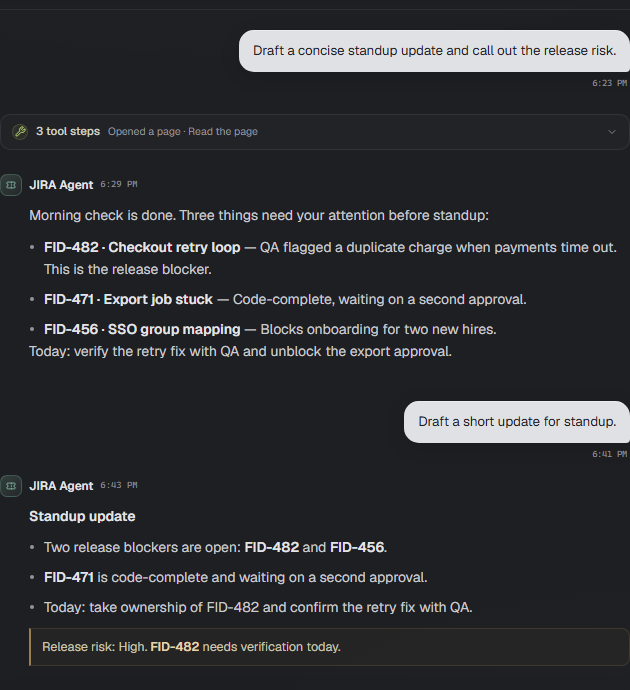

# Chat with an agent

The conversation is the center column. Messages stream in as the agent works, tool calls are grouped into one card, and every reply is saved locally with the agent.

## Send a message

Type in the composer and press **Enter**. Use **Shift+Enter** for a new line. The composer grows up to eight lines.

The agent can only answer after Copilot is connected. If the composer says "Sign in to Copilot to chat", open **Settings → Copilot** and sign in.

## Follow the work

While the agent runs, its current tool step is highlighted in the open tool card. Finished tool calls stay in the card above the reply. Expand it to see each call and a short summary of its result.

The conversation is saved in the local SQLite database. When Fid Coder rebuilds a Copilot session, it sends the last 30 messages, clipped to 12,000 characters, so the agent has recent context.

## Use the model picker

The model picker sits in the composer. **Auto** lets Copilot choose the model for the agent. Choose another model when the agent is idle; the picker is disabled while a turn is running.

## Stop a turn

Press the square stop button while the agent is working. Any partial reply is kept in the conversation with a note that the turn stopped.

## Approve a delete

The shell tool pauses before destructive commands. When that happens, a confirmation bar appears above the composer. Choose **Reject** or **Approve**. Nothing is deleted until you approve.

> **Tip:** Hover a reply and choose **Copy**, or use the copy button on a code block or diagram.
