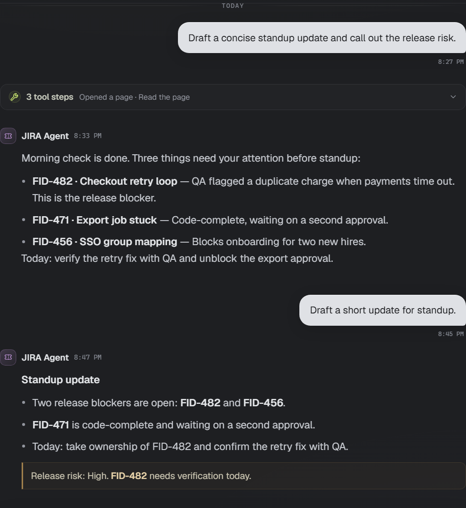
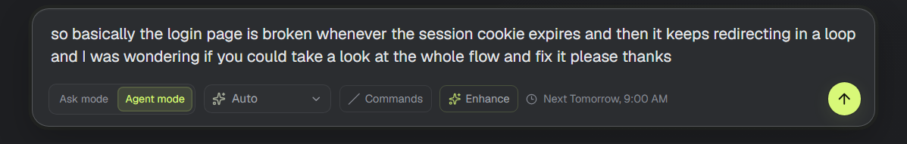

# Chat with an agent

The conversation is the center column. Messages stream in as the agent works, tool calls are grouped into one card, and every reply is saved locally with the agent.

## Send a message

Type in the composer and press **Enter**. Use **Shift+Enter** for a new line. The composer grows up to eight lines.

The agent can only answer after Copilot is connected. If the composer says "Sign in to Copilot to chat", open **Settings → Copilot** and sign in.

## Improve a draft

Choose **Enhance** next to **Commands** to rewrite the current draft. It makes the wording shorter and more specific, keeps paths, quotes, and slash commands, and uses the last few messages for context. Nothing is sent: the rewrite stays in the composer so you can edit it and send when ready. Choose **Undo** to restore the draft you had before the rewrite.

Enhance runs only when you choose it. It does not run on later messages and does not change what Send does. It uses Copilot quota and picks a cheap model when your account lists one. Composer commands and a running agent are skipped with a short reason; any other non-empty draft, including a short one, runs when you choose Enhance.

## Follow the work

While the agent runs, its current tool step is highlighted in the open tool card. Finished tool calls stay in the card above the reply. Expand it to see each call and a short summary of its result.

Day dividers mark **Today**, **Yesterday**, and older calendar dates. They stay at the top of the thread while you scroll that day. Hover any time to see the full date and timestamp.

The conversation is saved in the local SQLite database. When Fid Coder rebuilds a Copilot session, it sends the last 30 messages, clipped to 12,000 characters, so the agent has recent context.

## Use a command

Type `/` in the composer, or choose **Commands** next to the model picker, to open the command list.

- `/skills <skill-id> <task>` — load an installed skill for this message. Later messages keep a short used-skills list and can reload it.
- `/skills` — open the Skills library.
- `/review` — review uncommitted changes, staged changes, a branch, a PR number, or a path.
- `/help` — open this guide.

Use ↑/↓ to move, Enter or Tab to select, and Escape to close. A command that needs a workspace or developer tools shows the reason in the list. The empty conversation also shows the available commands as chips.

The **Skills** row at the bottom of the sidebar opens the library. It lists every installed skill, its source, version, and size, and has the **Upload skill** button. Skills are global; nothing from a skill is added to an agent until you use `/skills`. After that, later messages get a short used-skills list and the assistant can reload the skill when it needs it.

## Ask for a code review

A developer or all-tools agent has the **/review** command. Type `/review` and add `staged`, `branch <name>`, `pr <number>`, or a path. Leave the target empty to review the uncommitted changes. The review runs in a read-only session: it can read, search, and use git reads, but it cannot edit files, run shell commands, or control a browser. The report appears in the chat.

## Use the model picker

The model picker sits in the composer. **Auto** lets Copilot choose the model for the agent. The other choices are the models the signed-in Copilot session reports as selectable; if it reports none, only Auto is available. Choose another model when the agent is idle; the picker is disabled while a turn is running. The new model applies to the next reply. If Copilot cannot use the chosen model, the turn stops with an error instead of answering with a different model.

## See token and credit usage

Each assistant reply has a small usage line: the total tokens, the AI credits Copilot reported, and the model that produced that reply. Select it to see input, output, cache-read tokens, model calls, and a token-composition bar.

The model on this line is historical: it names the model that served that reply. Changing the picker does not rewrite earlier usage lines. When Copilot chose the model automatically, the line shows `Auto · <model>`.

AI credits appear when Copilot reports them for the model call. If the account or model does not report a credit cost, the credits value is hidden. A `~` means some model calls in the turn did not report a cost, so the amount is a subtotal.

> **Tip:** Cached tokens are part of input; they are not counted twice.

## Stop a turn

Press the square stop button while the agent is working. Any partial reply is kept in the conversation with a note that the turn stopped.

## Approve a command

The shell tool pauses before a delete, a git push, or a download. A compact approval card appears in the conversation with the command, working folder, and risk, plus an auto-deny countdown. Choose **Reject**, **Always deny**, **Always allow**, or **Allow once**.

**Always allow** and **Always deny** save a rule for that exact command and folder. Deny rules win over allow rules. Ending the turn or ignoring the countdown rejects the command. Every request and decision appears in the Agent Desk approvals history, and saved rules are under **Settings → Safety**.

## Recall an older issue

Ask the agent what you worked on earlier, or name the issue. It can search the saved conversation by text or date, read only the matching turn, load a small date window, or read the first message. The full transcript stays on this PC; the agent loads what it needs instead of replaying the whole conversation.

## Ask for a diagram

Ask for a flow, process, or architecture picture. The agent answers with a Mermaid block, and the app draws it as a diagram with zoom, horizontal scroll, and a **Source** toggle. Flowcharts are the default for architecture, control flow, and data flows; sequence diagrams are used when the order between actors over time matters. If a node label contains a `path:line`, choose the node to open the code reader. A **Linked code** list under the diagram opens the same files. A reply that already contains ASCII art still shows as text under a **Diagram** label.

Use **Expand** above a rendered diagram for a full-screen view with zoom. Use **Copy image** to copy the whole diagram as a PNG, including its colors, at full size regardless of the current zoom or scroll. Paste it directly into Confluence or another document. **Copy** copies the Mermaid source instead.

For a read-only question about a checked-out repository, start with **Ask mode** in the composer, before the model picker. The starter prompts and project map are described in **Understand a codebase**.

> **Tip:** Hover a reply and choose **Copy**, or use the copy button on a code block or diagram.
