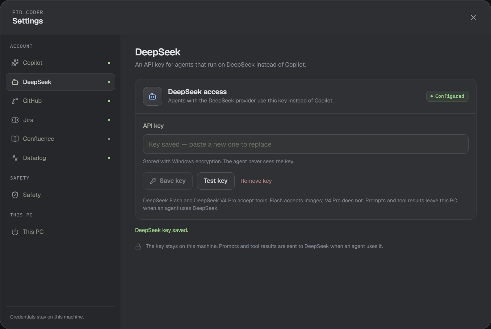
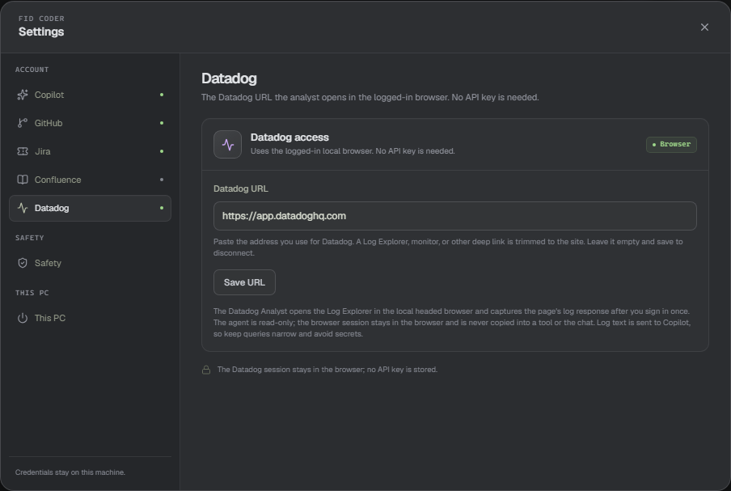
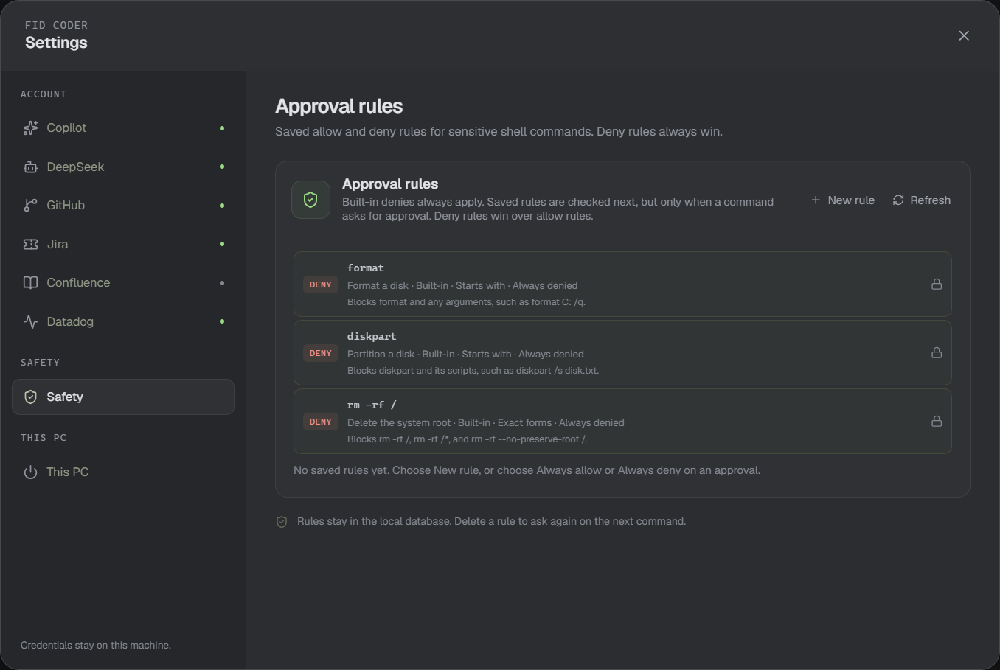

# Connect Copilot, DeepSeek, GitHub, Jira, Confluence, and Datadog

Copilot is the default account your agents use to think and call tools. DeepSeek is an optional second provider with its own API key; an agent can use either one. GitHub, Jira, and Confluence tokens are optional connections that give agents access to pull requests, Jira data, and Confluence pages. Datadog is optional too, but it uses the browser session instead of a token.

## Sign in to Copilot

Open **Settings → Copilot** and choose **Sign in with Copilot**. Finish the browser flow. The app checks the connection until your account appears. Use **Re-check** if the state looks stale, and **Sign out** to clear the saved session.

If the CLI is missing, install GitHub Copilot CLI and make sure `copilot` is on PATH.

## Add DeepSeek access

Open **Settings → DeepSeek** and paste a DeepSeek API key. Choose **Save key**, then **Test key**. The badge shows **Configured**, and the key is encrypted with Windows `safeStorage`. The agent never sees the key and it is never printed in chat.

DeepSeek is chosen per agent. Open the agent editor, choose **DeepSeek** under **Provider**, then pick a model from the list your key reports, such as **DeepSeek Flash** or **DeepSeek V4 Pro**. Existing agents stay on Copilot. A DeepSeek agent does not use your Copilot account, so it can run without a Copilot sign-in.

- DeepSeek models accept tools, so file, git, browser, Jira, Confluence, and routine turns work.
- DeepSeek Flash accepts images. DeepSeek V4 Pro does not; remove the image, choose Flash, or switch the agent to Copilot.
- DeepSeek turns show tokens, not Copilot AI credits. The sidebar usage bar remains Copilot quota.
- Prompts and tool results are sent to DeepSeek when an agent uses it. Check with your team before sending source code, tickets, or wiki text.

For tests and local development, the app also reads `FID_CODER_DEEPSEEK_API_KEY` or `DEEP_SEEK_API_KEY` from the environment when no key is saved. A saved key wins.

## Add a GitHub token

Open **Settings → GitHub** and paste a personal access token. Agents with shell tools receive it as `GH_TOKEN` and `GITHUB_TOKEN`. Remove the saved token with **Remove token**.

## Add Jira access

Open **Settings → Jira** and save the site URL and a personal access token (PAT). Use the Jira base URL. If Jira runs under a context path, include it, for example `https://jira.example.com/jira`. When both are saved, browser agents read the site with `jira_search`, `jira_issue`, and `jira_myself`. Without a site or token, or when you ask the agent to use the browser, it uses the browser instead. If a Jira tool fails, the app logs the failure and the agent uses the browser. Agents with shell tools also receive `JIRA_API_TOKEN` and `JIRA_SITE`.

The token is sent as a Bearer token. That works with a Jira Data Center PAT; Jira Cloud API tokens use Basic auth and are not supported yet.

## If Jira tools are not used

Jira tools are enabled only when both the site URL and the token are saved. The app writes a warning to `%USERPROFILE%\.fid_coder_app\logs\fid-coder.log` when:

- Jira tools are disabled because the site or token is missing.
- A Jira tool call fails, including a rejected token.

The warning includes the site, whether the token file exists, and the token file path. It never writes the token itself. If you set up Jira on a different machine, check that machine's log; settings are stored per app data folder.

When a Jira request fails, the chat shows only “Jira is unavailable.” The detailed cause — DNS (`ENOTFOUND`), a certificate problem, a proxy, a refused connection, or a timeout — goes to the log, along with each attempted API URL and a redacted response body snippet. Jira requests use Electron's network stack, so they follow the Windows proxy and certificate store. If Windows cannot decrypt a saved token, saving the token fails and the log records that instead.

## Add Confluence access

Open **Settings → Confluence** and choose the deployment:

- **Cloud** — save `https://your-site.atlassian.net` and the email on your Atlassian account. The token is an Atlassian API token, sent as Basic auth (`email:token`). The app adds `/wiki` to the REST calls.
- **Data Center/Server** — save the Confluence base URL, including a context path such as `/confluence`. The token is a personal access token, sent as a Bearer token.

Use **Save settings** for the site, email, and deployment, then **Save token** for the token. When both are saved, the agent gets three tools:

- `confluence_search` searches with CQL, for example `space = ENG AND text ~ "release notes"`.
- `confluence_page` reads a page by pasted URL, id, or space key and title, as text or storage XHTML. A short `/x/` link is followed on the saved site; a link outside that site is refused.
- `confluence_update_page` appends to or replaces a page. It reads the page first and requires its current version, so a page edited by someone else is refused instead of overwritten. The update shows the normal approval card before it writes.

A Markdown replace is refused when the page already contains Confluence macros, because that would drop them. Append keeps the existing storage body. The agent never receives the token.

Ask mode gets the two read-only tools; Agent mode adds `confluence_update_page`. A routine never gets the update tool. A browser agent can use the Confluence tools too; no extra folder is required.

## Add Datadog access

Open **Settings → Datadog** and save the address you use to open Datadog, such as `https://app.datadoghq.com`. A custom host is fine. A pasted Log Explorer, monitor, or other deep link is trimmed to the site.

**No API key is requested or stored.** Save the URL and close Settings. The badge shows **Browser**, and the Datadog Analyst uses the local headed browser:

1. Ask the Datadog Analyst to troubleshoot a symptom.
2. If Datadog asks for a sign-in, the **Needs you** card appears. Sign in in the visible browser, then choose **Done**.
3. The agent opens the Log Explorer with the query and time range, captures the page's JSON log response, and returns compact rows with service, environment, version, host, trace id, message, and stack.
4. It then reads the workspace, maps the stack to code, and reports the root cause.

The agent has two read-only tools: `datadog_browser_logs` searches the Log Explorer, and `datadog_browser_error_summary` groups the captured page sample into error patterns. Browser results are a page sample, not the full index; the agent labels them that way. The browser profile keeps the Datadog login for later turns.

The Datadog profile is read-only. It has no shell, file writes, browser click/type, or Confluence update. Log text is treated as untrusted data. The capture is limited to the configured Datadog origin and records JSON responses only, never cookies or request headers. The session credential stays in the browser; the agent and the model never see it.

Log text is sent to the agent's model provider as tool output. Keep queries narrow and avoid searching for secrets or customer data you should not send to the model.

## Review approval rules

Open **Settings → Safety** to review approval rules. Three built-in denies always apply and cannot be removed: `format`, `diskpart`, and the system-root `rm -rf /`. They are checked before any saved rule, so an allow rule cannot override them. `format` blocks `format` and any arguments, such as `format C: /q`; `diskpart` blocks `diskpart` and its scripts; `rm -rf /` blocks `rm -rf /`, `rm -rf /*`, and `rm -rf --no-preserve-root /`.

Below them, choose **New rule** to add a saved rule. Pick **All agents** or one agent, **Always allow** or **Always deny**, the command, **Exact command** or **Starts with**, and a folder (leave it empty for any folder). **Starts with** matches at a word boundary, so `git push` covers `git push --force` but not `git pushx`. Use the pencil to edit a saved rule and the trash button to delete it. Deny rules win over allow rules. A saved rule is checked when a sensitive command asks for approval; it does not make a command sensitive by itself.

## Where the credentials live

Jira, Confluence, GitHub, and DeepSeek credentials are encrypted with Windows `safeStorage` and stored in `secrets.bin.json` under `%USERPROFILE%\.fid_coder_app`. The app does not send the keys or tokens to the model or print them in chat. A local tool such as `gh` can use its token to call its own service. DeepSeek requests use the saved key as the API credential; the prompts for a DeepSeek agent go to DeepSeek. Jira diagnostics go to `%USERPROFILE%\.fid_coder_app\logs\fid-coder.log`.

There is no Datadog API key. The Datadog session lives in the agent's persistent browser profile, like any other browser login. Fid Coder does not copy the cookie or token out of the browser.

Saving or clearing a token, key, or the Jira, Confluence, or Datadog site drops every live model session. The saved conversations stay; the next message rebuilds context from the transcript.

> **Tip:** Copilot is the default provider. DeepSeek is optional per agent. GitHub, Jira, Confluence, and Datadog are optional connections. A browser agent reads Jira with a saved site and PAT, or through the browser when no PAT is saved. The Datadog Analyst always uses the logged-in local browser; no Datadog API key is stored.
