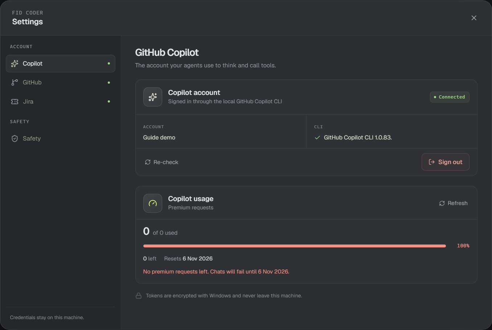

# Connect Copilot, GitHub, and Jira

Copilot is the account your agents use to think and call tools. GitHub and Jira tokens are optional connections that give developer agents access to pull requests and Jira data.

## Sign in to Copilot

Open **Settings → Copilot** and choose **Sign in with Copilot**. Finish the browser flow. The app checks the connection until your account appears. Use **Re-check** if the state looks stale, and **Sign out** to clear the saved session.

If the CLI is missing, install GitHub Copilot CLI and make sure `copilot` is on PATH.

## Add a GitHub token

Open **Settings → GitHub** and paste a personal access token. Agents with shell tools receive it as `GH_TOKEN` and `GITHUB_TOKEN`. Remove the saved token with **Remove token**.

## Add Jira access

Open **Settings → Jira** and save the site URL and a personal access token (PAT). When both are saved, browser agents read the site with `jira_search`, `jira_issue`, and `jira_myself`. Without a site or token, or when you ask the agent to use the browser, it uses the browser instead. If a Jira tool fails, the app logs the failure and the agent uses the browser. Agents with shell tools also receive `JIRA_API_TOKEN` and `JIRA_SITE`.

The token is sent as a Bearer token. That works with a Jira Data Center PAT; Jira Cloud API tokens use Basic auth and are not supported yet.

## If Jira tools are not used

Jira tools are enabled only when both the site URL and the token are saved. The app writes a warning to `%USERPROFILE%\.fid_coder_app\logs\fid-coder.log` when:

- Jira tools are disabled because the site or token is missing.
- A Jira tool call fails, including a rejected token.

The warning includes the site, whether the token file exists, and the token file path. It never writes the token itself. If you set up Jira on a different machine, check that machine's log; settings are stored per app data folder.

When a Jira request fails, the chat shows only “Jira is unavailable.” The detailed cause — DNS (`ENOTFOUND`), a certificate problem, a proxy, a refused connection, or a timeout — goes to the log. Jira requests use Electron's network stack, so they follow the Windows proxy and certificate store. If Windows cannot decrypt a saved token, saving the token fails and the log records that instead.

## Review approval rules

Open **Settings → Safety** to review saved allow and deny rules. Each rule names the agent, command, and folder. Choose the trash button to remove a rule and start asking again. Deny rules win over allow rules.

## Where the credentials live

Tokens are encrypted with Windows `safeStorage` and stored in `secrets.bin.json` under `%USERPROFILE%\.fid_coder_app`. The app does not send tokens to Copilot or print them in chat. A local tool such as `gh` can use its token to call its own service. Jira diagnostics go to `%USERPROFILE%\.fid_coder_app\logs\fid-coder.log`.

Saving or clearing a token or the Jira site drops every live Copilot session. The saved conversations stay; the next message rebuilds context from the transcript.

> **Tip:** Copilot is required. GitHub and Jira are optional. A browser agent reads Jira with a saved site and PAT, or through the browser when no PAT is saved.
