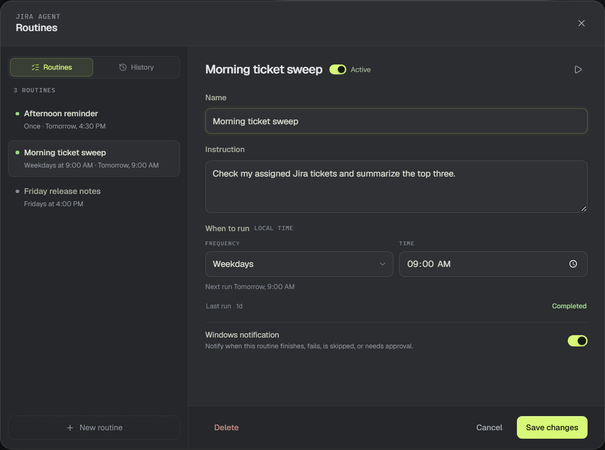
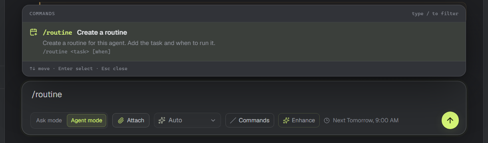
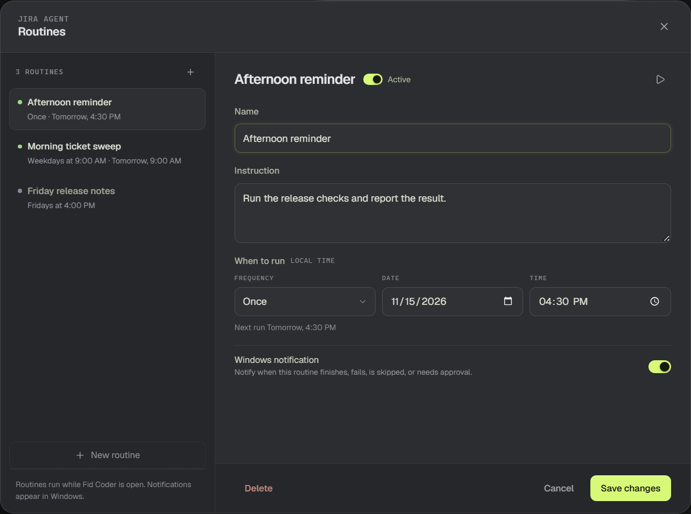
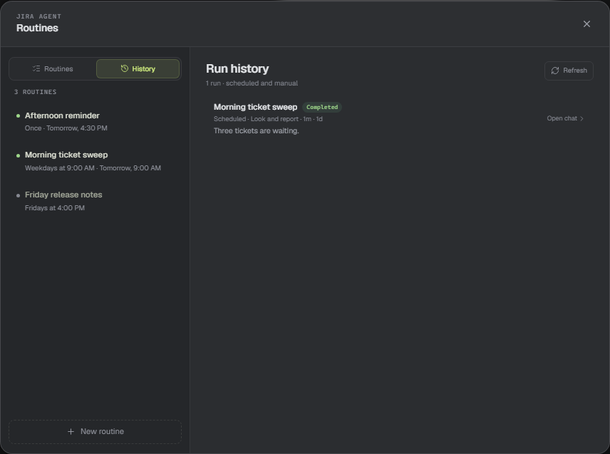

# Create a routine

A routine sends a saved instruction to an agent at a time you choose. It can run once or repeat. The result lands in that agent's conversation. Fid Coder can raise a Windows notification, and the sidebar bell keeps approvals, failed turns, and finished runs.

## Limitation

Routines run only while Fid Coder is open. Closing the window quits the app, so a routine does not keep running in the tray and does not start at login.

A time that passes while the app is closed is not run later.

- A one-time routine is marked **Missed** and paused. Its instruction does not run.
- A repeating routine keeps its next time. The missed slot is skipped.

Leave Fid Coder open when you want a routine to run.

## Create from chat

Type `/routine` followed by the task and when to run it:

- `/routine run the release checks at 4 PM`
- `/routine every weekday at 9, check my open tickets`

The agent translates the local time into the routine's frequency, time, date, or weekday fields and calls `routine_create` once. It reports the timing, the next run, and the stored instruction so you can confirm what will run later. The routine creation tool is available only during a `/routine` message, so an ordinary chat message cannot create a routine. If you leave out the task or the time, the agent asks; send the complete `/routine` request again. Switch to Agent mode if the composer says the command needs it.

You can still ask the agent what routines exist or cancel one with `routine_list` and `routine_delete`; the Routines dialog is also there.

Each run is a normal agent turn and uses your Copilot quota. A command run by a routine still follows the usual approval rules.

## Open Routines

In the Agent Desk, choose **Manage routines** or the **+** beside the Routines section. The dialog lists every routine for the selected agent, including routines the agent created in chat.

## Write the instruction

Give the routine a name and an instruction. Write it the way you would write a chat message. The routine runs that instruction as a turn, with a `[Routine]` prefix in the transcript.

## Choose when it runs

Choose **Once**, **Every day**, **Weekdays**, **Every week**, or **Custom**. Times use the PC's local time. For **Once**, also pick a date. For **Custom**, enter a five-field cron expression such as `0 9 * * 1-5`.

The next run appears under the fields. Save the routine to recalculate it. See the limitation above: a slot that passes while Fid Coder is closed does not run.

## Notifications and status

Leave **Windows notification** on to be notified when a scheduled run finishes, fails, is skipped, or is missed. Click the toast to open that agent. The desk row shows the last status.

If the agent is already working, the run is marked **Skipped**. A one-time routine is used up by that skip. A repeating routine waits for its next time.

## History

Choose the **History** tab at the top of the routine list. A row shows the routine, status, whether it was scheduled or manual, how long it took, and a short excerpt. **Open chat** closes the dialog. **Refresh** loads newer runs, and **Stop** is there only while a run is still going.

## Inbox

The bell lists approvals, failed chat turns, and finished scheduled runs. Open a row to go to that agent. **Snooze** hides a routine or a failed turn for four hours. An approval stays until you answer it.

## Tray and pause

While Fid Coder is open, the tray menu can open the window, pause or resume every routine, or quit. The tooltip shows how many items are waiting. Quitting from the tray stops routines.

**Settings → This PC** can pause every routine. Scheduled runs wait until you resume them. **Run now** still works. Closing the window quits the app and stops routines.

## Run once or pause

Use the play button in the routine header to run it now. Save any changes first; the button stays disabled while the form is dirty. Running a one-time routine manually does not consume its next run. The switch in the header pauses or resumes that routine.

> **Tip:** A manual run does not follow the routine timing, does not send a Windows notification, and does not enter the inbox.
