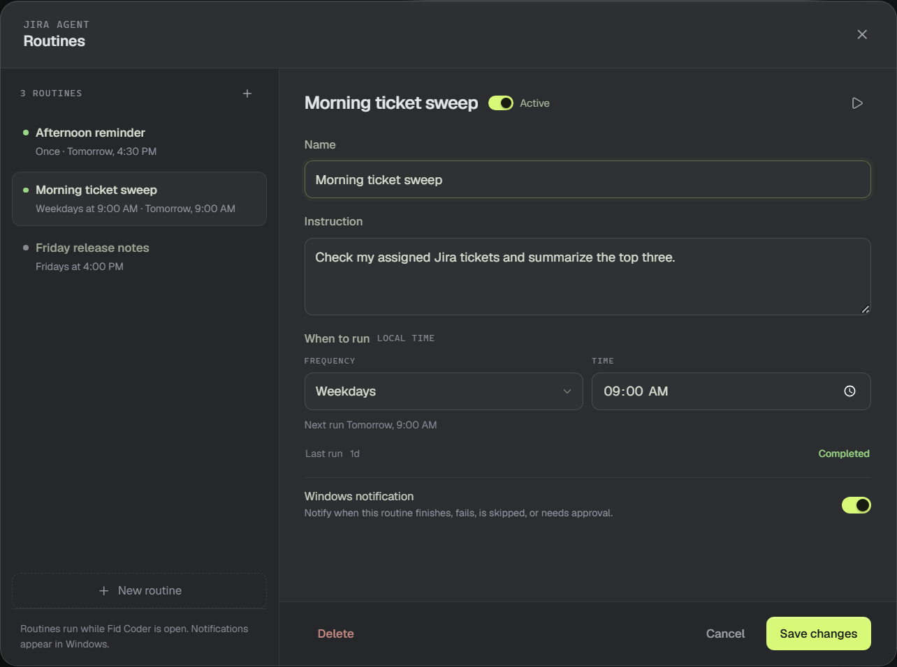
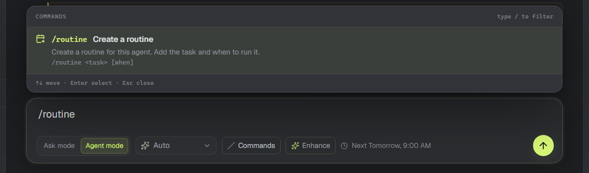
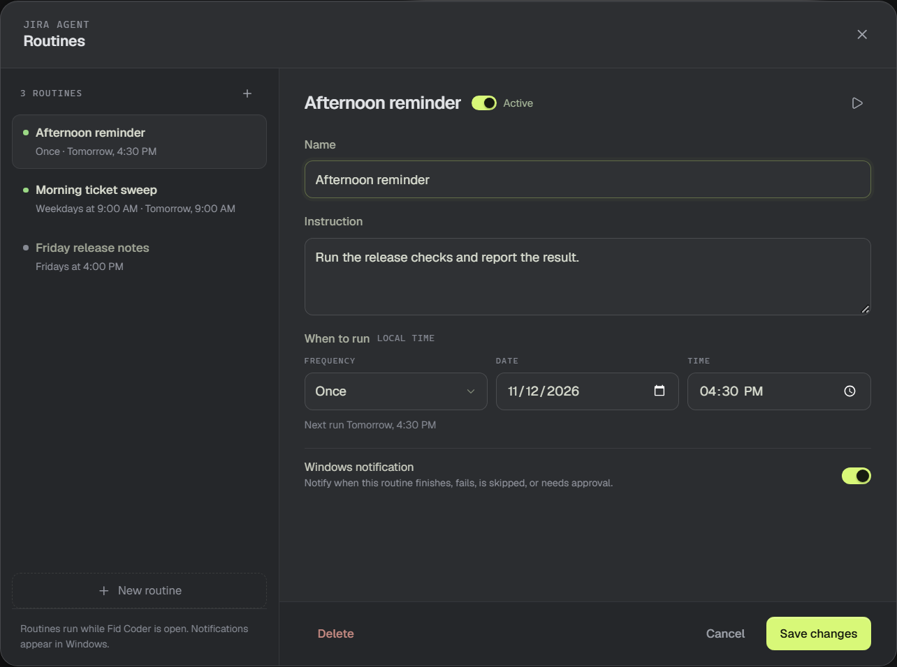

# Create a routine

A routine sends a saved instruction to an agent at a time you choose. It can run once or repeat. The result lands in the same conversation, and Fid Coder can raise a Windows notification when a run finishes, fails, is skipped, or needs approval.

## Create from chat

Type `/routine` followed by the task and when to run it:

- `/routine run the release checks at 4 PM`
- `/routine every weekday at 9, check my open tickets`

The agent translates the local time into the routine's frequency, time, date, or weekday fields and calls `routine_create` once. It reports the timing, the next run, and the stored instruction so you can confirm what will run later. The routine creation tool is available only during a `/routine` message, so an ordinary chat message cannot create a routine. If you leave out the task or the time, the agent asks; send the complete `/routine` request again. Switch to Agent mode if the composer says the command needs it.

You can still ask the agent what routines exist or cancel one with `routine_list` and `routine_delete`; the Routines dialog is also there.

Each run is a normal agent turn and uses your Copilot quota. A command run by a routine still follows the usual approval rules.

## Open Routines

In the Agent Desk, choose **Manage routines** or the **+** beside the Routines section. The dialog lists every routine for the selected agent, including routines the agent created in chat.

## Write the instruction

Give the routine a name and an instruction. Write it the way you would write a chat message. The routine runs that instruction as a turn, with a `[Routine]` prefix in the transcript.

## Choose when it runs

Choose **Once**, **Every day**, **Weekdays**, **Every week**, or **Custom**. Times use the PC's local time. For **Once**, also pick a date. For **Custom**, enter a five-field cron expression such as `0 9 * * 1-5`.

The next run appears under the fields. Save the routine to recalculate it.

A one-time routine that could not run because Fid Coder was closed is marked **Missed** and paused. Repeating routines keep their timing.

## Notifications and status

Leave **Windows notification** on to be notified when a routine run finishes, fails, is skipped, or needs your approval. The routine records its last run time and status: Completed, Missed, Skipped, or Failed.

Routines run only while Fid Coder is open. If the agent is already working when a routine fires, the run is marked **Skipped: agent busy** instead of queued. A one-time routine is consumed by that skip; a repeating routine waits for its next time.

## Run once or pause

Use the play button in the routine header to run it now. Save any changes first; the button stays disabled while the form is dirty. Running a one-time routine manually does not consume its next run. The switch in the header pauses or resumes the routine. A paused routine does not run until you enable it again.

> **Tip:** A manual run does not follow the routine timing and does not send a Windows notification.
