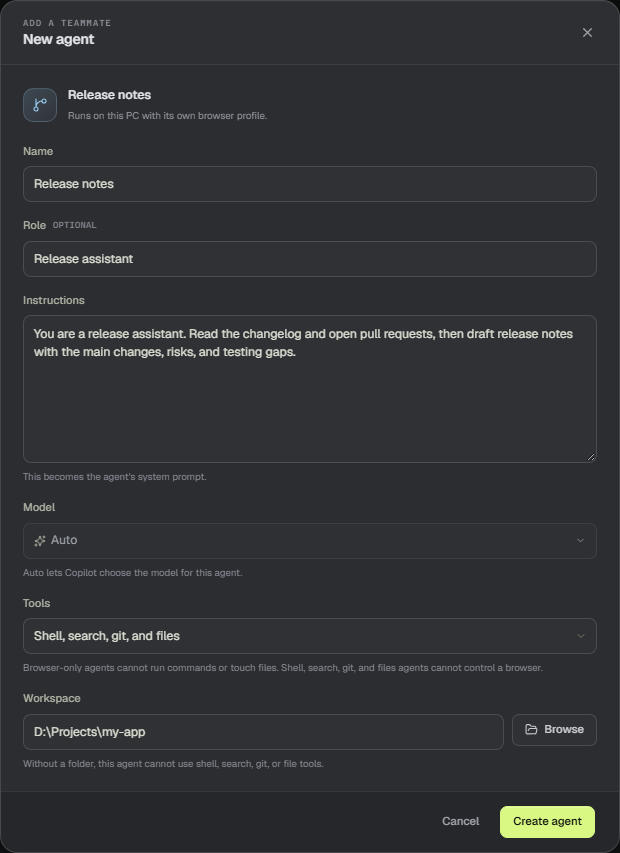

# Create your first agent

An agent is a saved teammate on this PC. It has its own instructions, model, tool access, browser profile, and conversation. This guide creates a developer agent that can read a repository and draft release notes.

## Before you start

- Sign in to Copilot from **Settings → Copilot**. The agent cannot answer until Copilot is connected.
- Have the folder you want the agent to work in. File, search, git, and shell tools need a workspace folder.
- Decide the job in one sentence. "Draft release notes from the changes since the last tag" is easier to test than "help with releases."

## Open the editor

Select **+** at the top of the sidebar, or **New agent** below the agent list. The editor opens with a preview of the agent and the fields that define it.

## Fill in the identity

1. **Name.** Use a short name that reads well in the sidebar, such as "Release notes."
2. **Role.** Add a short description. It appears under the name and helps you tell agents apart. "Release assistant" is enough.

## Write the instructions

Instructions become the agent's system prompt. Write them as a brief for a teammate: what to do, what to avoid, and how to reply.

> You are a release assistant. Read the changelog and open pull requests, then draft release notes with the main changes, risks, and testing gaps.

Keep the first version short. You can edit the agent later from the menu on its sidebar row.

## Choose tools and a workspace

- **All tools** gives the agent the browser, Jira, files, search, git, and shell.
- **Browser and Jira** is for web work and a saved Jira site. It cannot run commands or touch files.
- **Shell, search, git, and files** is for code work. It cannot control a browser or read Jira.

For this release assistant, choose **Shell, search, git, and files** and pick the repository folder. The file and search tools stay inside that folder. The shell starts in that folder too, but it is not a full sandbox. Without a workspace folder, the local tools stay unavailable.

## Save and send the first message

Select **Create agent**. The agent appears in the sidebar and opens in the chat. Type a message and press Enter. Tool steps appear as the agent works; finished calls collapse into a card you can expand.

> **Tip:** Start with **Auto** in the model picker. You can switch models from the composer when the agent is idle.

## What happens next

The agent stores its conversation locally. Your next message continues the same thread, and the Agent Desk shows the workspace, routines, and live browser for the selected agent.

If the first reply misses the mark, edit the instructions rather than repeating the request. Clear instructions are the main lever on agent behavior.
