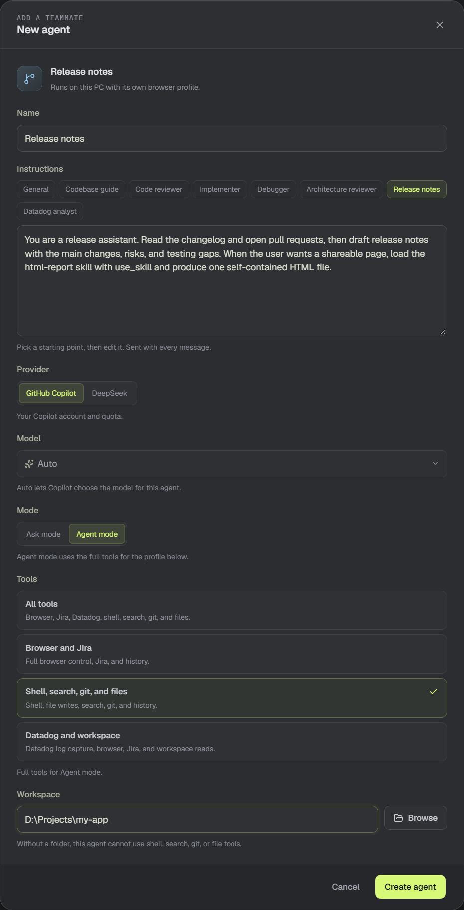

# Create your first agent

An agent is a saved teammate on this PC. It has its own instructions, model, tool access, browser profile, and conversation. This guide creates a developer agent that can read a repository and draft release notes.

## Before you start

- Sign in to Copilot from **Settings → Copilot**. The agent cannot answer until Copilot is connected.
- Have the folder you want the agent to work in. File, search, git, and shell tools need a workspace folder.
- Decide the job in one sentence. "Draft release notes from the changes since the last tag" is easier to test than "help with releases."

## Open the editor

Select **+** at the top of the sidebar, or **New agent** below the agent list. The editor opens with a preview of the agent and the fields that define it.

Give the agent a name. **Mode** decides access. **Ask mode** gives the agent every read-only tool, so there is nothing else to choose. Switch to **Agent mode** to pick a tool profile; the editor starts with none selected and keeps **Create agent** disabled until you choose one. You can change every field later.

## Name the agent

Use a short name that reads well in the sidebar, such as "Release notes."

## Write the instructions

Instructions become the agent's system prompt and are sent with every message. Pick a starting point from the presets above the box (General, Codebase guide, Code reviewer, Implementer, Debugger, Architecture reviewer, or Release notes), then edit it. The Code reviewer, Implementer, Architecture reviewer, and Release notes presets point the agent at the bundled skills, so it loads the detailed checklist only when the task needs it. The text stays yours: change the wording, add a constraint, or write it from scratch.

Write standing guidance for a teammate: what to do, what to avoid, and how to reply. Put a one-time request in the chat instead.

> You are a release assistant. Read the changelog and open pull requests, then draft release notes with the main changes, risks, and testing gaps.

Keep the first version short. You can edit the agent later from the menu on its sidebar row.

## Choose mode, tools, and a workspace

In **Agent mode**, **Tools** offers three profiles:

- **All tools** gives the agent the browser, Jira, files, search, git, and shell.
- **Browser and Jira** is for web work and a saved Jira site. It cannot run commands or touch files.
- **Shell, search, git, and files** is for code work. It cannot control a browser or read Jira.

In Agent mode, choose one explicitly; the editor does not preselect All tools. For this release assistant, switch to **Agent mode**, choose **Shell, search, git, and files**, and pick the repository folder. The file and search tools stay inside that folder. The shell starts in that folder too, but it is not a full sandbox. Without a workspace folder, the local tools stay unavailable.

**Mode** decides access. **Ask mode** registers every read-only tool — file reads, search, git, browser pages, and Jira — so there is no tool profile to choose; the browser can navigate and snapshot but not click or type. **Agent mode** lets you pick **Tools**: all tools, Browser and Jira, or shell/search/git/files. The **Ask mode / Agent mode** switch in the composer changes the same setting. The choice is saved for the agent. Instructions describe the role; they do not grant or deny access.

Skills are not assigned in the editor. Open **Skills** in the sidebar to browse or upload them, then use `/skills <skill> <task>` in the chat. See **Use skills on demand** in this guide.

## Save and send the first message

Select **Create agent**. The agent appears in the sidebar and opens in the chat. Type a message and press Enter. Tool steps appear as the agent works; finished calls collapse into a card you can expand.

> **Tip:** Start with **Auto** in the model picker. You can switch models from the composer when the agent is idle.

## What happens next

The agent stores its conversation locally. Your next message continues the same thread, and the Agent Desk shows the workspace, routines, and live browser for the selected agent.

If the first reply misses the mark, edit the instructions rather than repeating the request. Clear instructions are the main lever on agent behavior.
