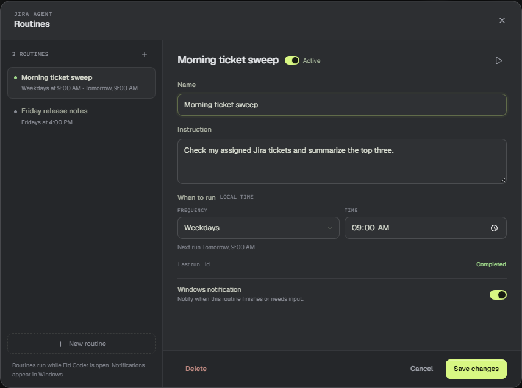

# Schedule a routine

A routine sends a saved instruction to an agent on a schedule. The result lands in the same conversation, and Fid Coder can raise a Windows notification when the run finishes or fails.

## Open Routines

In the Agent Desk, choose **Manage routines** or the **+** beside the Routines section. The dialog lists every routine for the selected agent.

## Write the instruction

Give the routine a name and an instruction. Write it the way you would write a chat message. The routine runs that instruction as a scheduled turn, with a `[Routine]` prefix in the transcript.

## Pick a schedule

Choose **Every day**, **Weekdays**, **Every week**, or **Custom**. Times use the PC's local time. For a custom schedule, enter a five-field cron expression such as `0 9 * * 1-5`.

The next run appears under the schedule field. Save the routine to recalculate it.

## Notifications and status

Leave **Windows notification** on to be notified when a scheduled run finishes or fails. The routine also records its last run time and status: Completed, Skipped, or Failed.

Routines run only while Fid Coder is open. If the agent is already working when a routine fires, the run is marked **Skipped: agent busy** instead of queued.

## Run once or pause

Use the play button in the routine header to run it now. Save any changes first; the button stays disabled while the form is dirty. The switch in the header pauses or resumes the routine. A paused routine does not run until you enable it again.

> **Tip:** A manual run does not follow the schedule and does not send a Windows notification.
