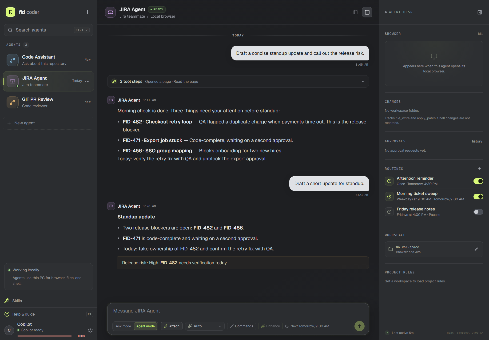
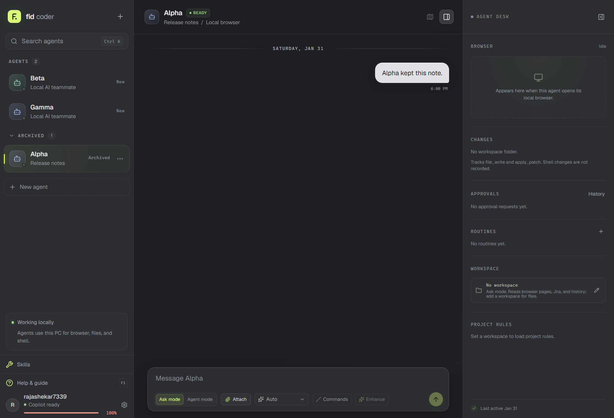
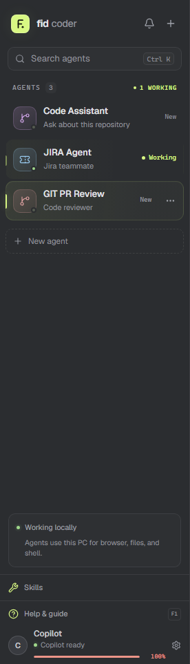

# The cockpit at a glance

Fid Coder is one window with three working areas. The sidebar chooses an agent, the center column is the conversation, and the Agent Desk shows what the agent is doing on this PC.

The window has no separate title strip. Drag it from the sidebar header or any top pane header. The Windows minimize, maximize, and close controls stay at the top right.

## Sidebar

The sidebar lists the agents on this machine. Archived agents stay out of that list until you open them.

- Press **Ctrl+K**, type a name, and press Enter to open the first match. Escape clears the search. The search also matches the short description and includes archived agents.
- Select **+** at the top or **New agent** below the list to create an agent.
- Open the menu on an agent row to pin, archive, edit, or delete it. **Pin** keeps the agent at the top and shows a pin on the row. **Archive** hides it under **Archived** and keeps the conversation, routines, and browser profile. **Restore** brings it back, including a pin it already had. Deleting an agent removes the conversation, routines, and browser profile.
- The date on the right is the last activity: **Today**, **Yesterday**, or the calendar date. Hover it for the full timestamp. A green dot means the agent was active in the last 15 minutes. An archived row says **Archived** in that spot. While an agent is working on a turn, that spot says **Working** with a pulsing dot, and the **Agents** header counts the agents that are working.
- **Skills** at the bottom of the sidebar opens the global library. Use **Upload skill** there to add a folder with `SKILL.md`.

## Conversation

The center column is the saved conversation for the selected agent.

- Replies stream in as Copilot writes them.
- Tool calls collapse into one card. The running step is highlighted; expand the card to see each call and a short result summary.
- The composer at the bottom sends with Enter. Use Shift+Enter for a new line.
- **Mode** in the agent editor chooses access. Ask mode uses every read-only tool; Agent mode reveals **Tools** for the domain. **Ask mode** and **Agent mode** in the composer, before the model picker, change the same saved mode between read-only questions and the agent's full tools.
- The map button in the chat header opens the cached project map. Choose **Build map** or **Refresh map** to spend one read-only exploration.
- The **Workspace** button in the chat header, `/files`, or **Browse files** on the Agent Desk opens the workspace navigator: the answer's references, the selected turn's changed files, and the full file tree. The entries are hidden without a workspace folder. It opens even before a turn has changed a file. On a wide window, **Collapse chat** in the panel header slides the chat left; **Show chat** restores it. Drag the divider between the chat and the panel to resize both, or choose **Hide file list** to collapse the References/Changed/All files column; **Show file list** brings it back. The panel width is remembered. It replaces the Agent Desk while open; close it to return to the desk.
- Choose **Enhance** to rewrite the draft; nothing is sent until you press Enter. It is manual and one-shot.
- The model picker is in the composer. It is disabled while the agent is working.
- Type `/` in the composer, or choose **Commands**, to open the command list. `/skills <skill> <task>` uses an installed skill for that message.
- The status pill beside the agent name shows Ready, Working, or Sign in.

## Agent Desk

The right column shows the selected agent's local work.

- **Browser** shows a live preview when a browser agent opens a page. Choose Open browser to bring the real window to the front. It opens maximized, and the page reflows when you resize or maximize the window.
- **Changes** is a one-line summary of the latest edited turn. Choose **Open changes** for the turn picker, diff, and file tree.
- **Approvals** shows recent allow, deny, and timeout decisions. Choose History for the full audit.
- **Routines** lists saved routines. Use the switch to pause one, or the plus to manage them. A routine runs only while Fid Coder is open. Closing the app skips a slot that comes due while it is closed.
- The bell beside **New agent** opens **Needs you**. **Waiting on you** groups approvals, questions, browser handoffs, and skill saves by agent, and you can answer them there. **Updates** lists failed turns and finished routine runs. **Routines** lists every agent's routines.
- **Workspace** shows the folder a developer agent can read, search, and edit. Browser-only agents show no workspace.
- The desk opens automatically at 1181 px and wider. Use the panel button in the chat header to hide or show it.

> **Tip:** Press **F1** to open this guide. The Help & guide row at the bottom of the sidebar does the same thing.
