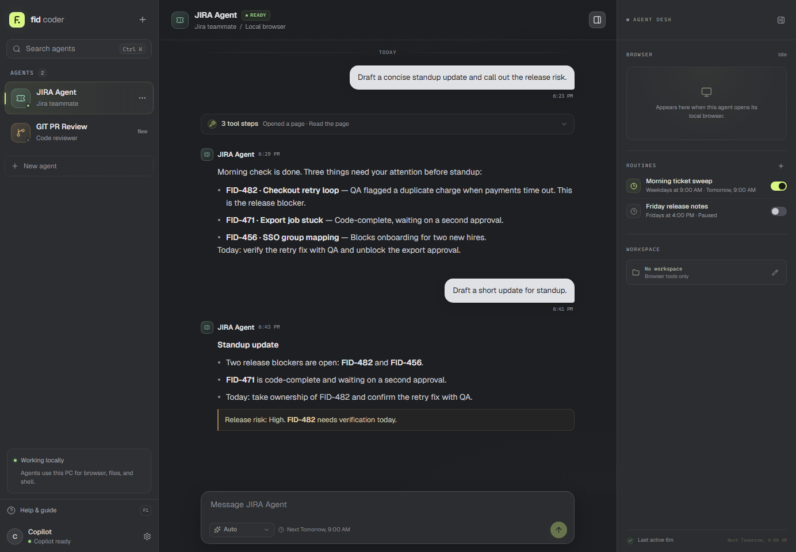

# The cockpit at a glance

Fid Coder is one window with three working areas. The sidebar chooses an agent, the center column is the conversation, and the Agent Desk shows what the agent is doing on this PC.

## Sidebar

The sidebar lists every agent on this machine.

- Search with **Ctrl+K**, then press Escape to clear the search.
- Select **+** at the top or **New agent** below the list to create an agent.
- Open the menu on an agent row to edit or delete it. Deleting an agent also removes its conversation, routines, and browser profile.
- The time on the right is the last activity. A green dot means the agent was active in the last 15 minutes.

## Conversation

The center column is the saved conversation for the selected agent.

- Replies stream in as Copilot writes them.
- Tool calls collapse into one card. The running step is highlighted; expand the card to see each call and a short result summary.
- The composer at the bottom sends with Enter. Use Shift+Enter for a new line.
- The model picker is in the composer. It is disabled while the agent is working.
- The status pill beside the agent name shows Ready, Working, or Sign in.

## Agent Desk

The right column shows the selected agent's local work.

- **Browser** shows a live preview when a browser agent opens a page. Choose Open browser to bring the real window to the front.
- **Routines** lists scheduled prompts. Use the switch to pause one, or the plus to manage them.
- **Workspace** shows the folder a developer agent can read, search, and edit. Browser-only agents show no workspace.
- The desk opens automatically at 1181 px and wider. Use the panel button in the chat header to hide or show it.

> **Tip:** Press **F1** to open this guide. The Help & guide row at the bottom of the sidebar does the same thing.
