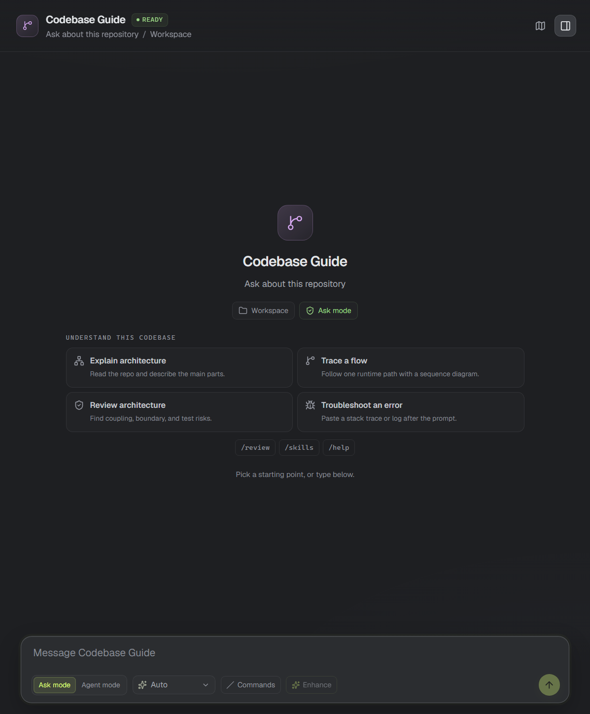
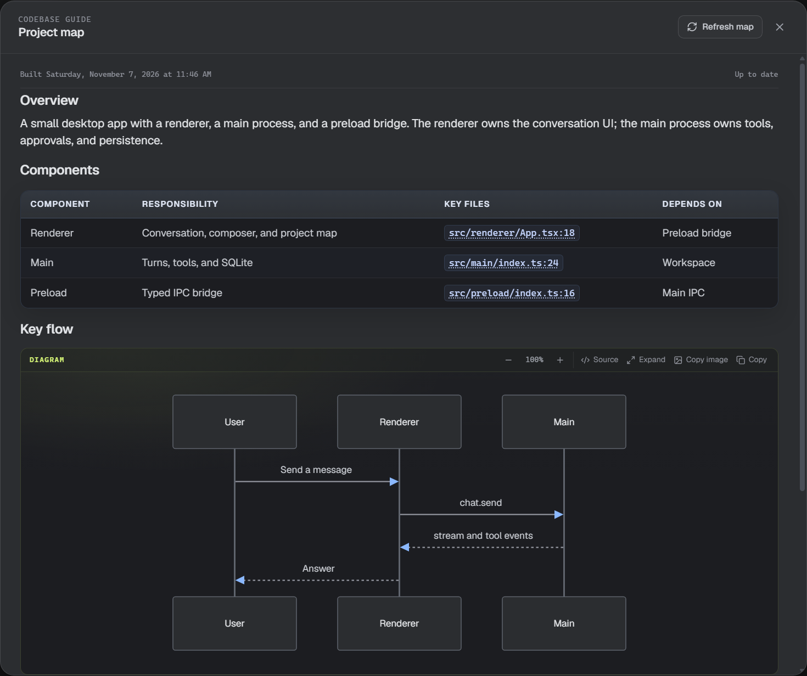
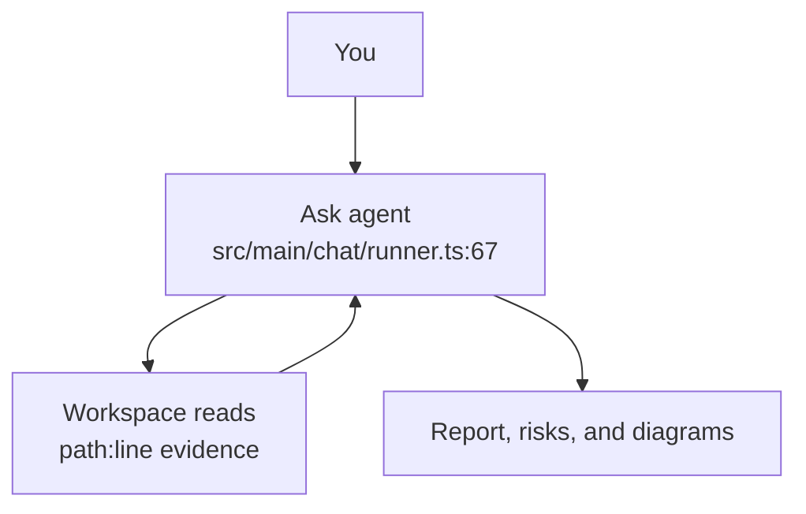

# Understand a codebase

Most questions about a checked-out repository do not need an edit. Ask mode reads the workspace, follows the code, and answers with evidence. It cannot write files, run commands, use the browser, or change git.

## Ask mode

Choose **Ask mode** in the composer, before the model picker, to use the read-only tool set: file reads, search, a workspace explorer, git status/diff/log, and pull-request reads. Choose **Agent mode** when the agent should edit, run tests, or use its full tool profile. The switch is saved for the agent, and the conversation is kept when you switch.

The read-only guarantee is enforced by the tools the agent receives, not only by its instructions. A question that needs a command or a change ends with a suggestion to switch to Agent mode.

For a **Browser & Jira** agent, Ask mode keeps the read-only Jira tools and page reading with `browser_navigate` and `browser_snapshot`. It blocks clicking, typing, and form actions. Switch to Agent mode when the agent needs to operate a page.

When the thread is empty and the agent has a workspace, four starting points appear:

- **Explain architecture** — a one-paragraph overview, entry points, and main modules.
- **Trace a flow** — a Mermaid flowchart with numbered steps.
- **Review architecture** — the built-in `architecture-review` skill.
- **Troubleshoot an error** — a prompt where you paste a stack trace or log.

Choosing one fills the composer. Nothing is sent until you press Send.

## Project map

Choose the map button in the chat header to open the project map. On first use it offers **Build map**. One read-only exploration produces:

- an overview and entry points;
- a component table with key files;
- key runtime flows as Mermaid flowcharts with linked code;
- a suggested reading order;
- build and test commands;
- risks and unknowns.

The map is cached for the workspace and marked **Up to date** or **The repository changed since this map was built.** Choose **Refresh map** to rebuild it. Building a map spends one Copilot turn; opening a saved map does not. The cache key comes from git; in a folder that is not a git repository, choose **Refresh map** after changing files.

## Architecture review and flows

`Review architecture` invokes the built-in skill. It returns a structured review: components, flows, boundaries, coupling, a risk table with evidence, test and observability gaps, and an explicit confidence and unknowns section. It is not a diff review; use `/review` for a change.

Flowcharts are the default for module structure, control flow, and data flows. Sequence diagrams are used when the order between actors over time is the point. Data models can use an ER diagram. In a conversation, a node whose label contains `path:line` is clickable, and a **Linked code** list under the diagram opens the same files. Expand any diagram to a full-screen view, zoom it, copy it as an image, or switch to its source. Expand, zoom, copy, and source also work in the help guide.

## Evidence and the code reader

Architecture answers cite files as `path:line`, for example `src/main/chat/runner.ts:420`. Choose the citation to open the read-only code reader. It highlights the exact line range, adds syntax colors, and scrolls to the cited code. A **path:line** that names a range such as `bench.ps1:34-42` highlights the whole range.

The reader keeps previously opened files in tabs, so you can compare two parts of the answer without leaving the app. The **Code references** list shows every citation in the answer; choose one to open it as a tab without closing the reader. Use **Back** and **Forward** (or `Alt+Left` and `Alt+Right`) to return to an earlier citation in the same file. **Copy path and line** copies a reference you can paste into a ticket or a chat. The reader is limited to a window around the citation; it does not modify the file.

## Troubleshooting

Use **Troubleshoot an error** and paste the stack trace or log after the prompt. Ask mode reads the code and log and explains the likely cause with evidence. If the answer needs a build or test run, switch to **Agent mode**.

## Start a codebase guide

When you create an agent, **Codebase guide** is the default template. It sets Ask mode, a short read-only instruction, and the developer tool profile for command availability. Choose **General agent** for an agent that edits and runs commands.

> **Keep in mind:** Ask mode is a tool boundary, not a sandbox. It can read any text file inside the workspace, so keep secrets out of the repository. It never writes, runs shell commands, or changes git.
