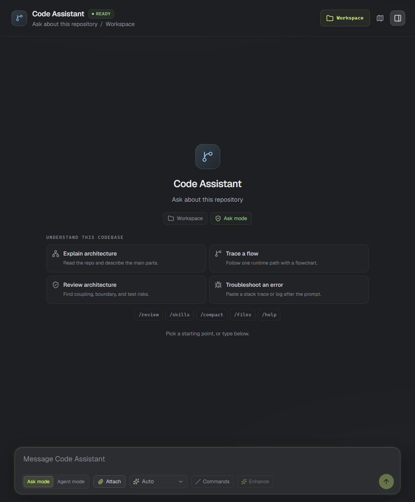
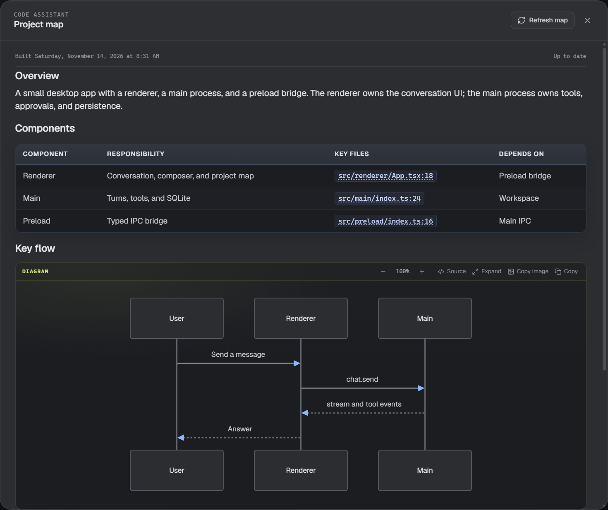
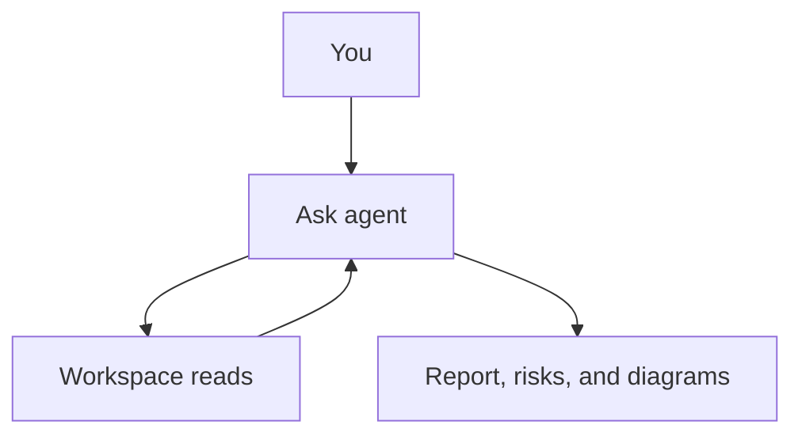

# Understand a codebase

Most questions about a checked-out repository do not need an edit. Ask mode reads the workspace, follows the code, and answers with evidence. It cannot write files, run commands, click or type in the browser, or change git.

## Ask mode

Choose **Ask mode** in the agent editor or in the composer, before the model picker. Ask mode ignores the tool profile and registers every read-only tool: file reads, search, spreadsheets, a workspace explorer, git status/diff/log, pull-request reads, browser navigate/snapshot, Jira and Confluence reads, and history. Choose **Agent mode** when the agent should edit, run tests, or use its full tool profile; Tools appears only in Agent mode. The switch is saved for the agent, and the conversation is kept when you switch.

The read-only guarantee is enforced by the tools the agent receives, not only by its instructions. A question that needs a command or a change ends with a suggestion to switch to Agent mode.

For a **Browser & Jira** agent, Ask mode keeps the read-only Jira and Confluence tools and page reading with `browser_navigate` and `browser_snapshot`. It blocks clicking, typing, and form actions. Switch to Agent mode when the agent needs to operate a page.

When the thread is empty and the agent has a workspace, four starting points appear:

- **Explain architecture** — a one-paragraph overview, entry points, and main modules.
- **Trace a flow** — a Mermaid flowchart with numbered steps.
- **Review architecture** — the built-in `architecture-review` skill.
- **Troubleshoot an error** — a prompt where you paste a stack trace or log.

Choosing one fills the composer. Nothing is sent until you press Send.

## Project map

Choose the map button in the chat header to open the project map. On first use it offers **Build map**. One read-only exploration produces:

- an overview and entry points;
- a component table with key files;
- key runtime flows as Mermaid flowcharts with clean labels;
- a suggested reading order;
- build and test commands;
- risks and unknowns.

The map is cached for the workspace and marked **Up to date** or **The repository changed since this map was built.** Choose **Refresh map** to rebuild it. Building a map spends one Copilot turn; opening a saved map does not. The cache key comes from git; in a folder that is not a git repository, choose **Refresh map** after changing files.

## Architecture review and flows

`Review architecture` invokes the built-in skill. It returns a structured review: components, flows, boundaries, coupling, a risk table with evidence, test and observability gaps, and an explicit confidence and unknowns section. It is not a diff review; use `/review` for a change.

Flowcharts are the default for module structure, control flow, and data flows. Sequence diagrams are used when the order between actors over time is the point. Data models can use an ER diagram. Use component names, not file names or `path:line` references, in diagram labels; put the evidence in the prose and numbered steps. The **References** section in the Workspace panel still shows every citation in the answer. Expand any diagram to a full-screen view, zoom it, copy it as an image, or switch to its source. Expand, zoom, copy, and source also work in the help guide.

## Evidence and the Workspace panel

Architecture answers cite files as `path:line`, for example `src/main/chat/runner.ts:420`. Choose the citation to open it in the Workspace panel. If the answer gives only a file name, such as `Test.java:123`, the app opens it when that name is unique in the workspace; if several files share the name, the panel says so and lists the candidates. To browse without a citation, choose **Workspace** in the chat header. If the file belongs to a recorded turn, the panel shows its diff with the cited lines marked. If the file has no recorded change, the panel shows the current file read-only with syntax colors and the cited range highlighted. A **path:line** that names a range such as `bench.ps1:34-42` highlights the whole range. The same panel reviews an agent's edits; there is no separate code window.

The **References** section lists every citation in the answer. Choose one to open that file and range in place. Files with a recorded change are marked **changed** and open as a diff; the rest open as a read-only file. Use the **Changed** section to browse the turn's files, or **All files** to explore the rest of the workspace. **All files** loads one folder at a time, marks files changed in the selected turn, and opens files read-only; **View diff** returns to the recorded change. Markdown files open as a rendered document and HTML files open in a sandboxed preview; use **Preview / Source** to switch. The panel reads a window around the citation and never modifies the file.

To ask about code you found yourself, open the file in the Workspace panel. The file is already the active context for your next message, and the last file you visit wins. Click a line number and drag or shift-click to narrow it to a range; the active chip in the composer shows the file or range. Press **Ctrl+Shift+L** or use the chip's pin action to keep it, then move to another file and pin that too. Pinned chips are sent together; the agent decides what to use. You can also use the paperclip in the composer to attach a local file; a text or code upload is copied into `.fid/uploads/` so the agent can read it, and an image is sent as an image.

## Troubleshooting

Use **Troubleshoot an error** and paste the stack trace or log after the prompt. Ask mode reads the code and log and explains the likely cause with evidence. If the answer needs a build or test run, switch to **Agent mode**.

## Start an agent for codebase questions

Create an agent and leave **Mode** on **Ask**. There is no tool profile to choose: Ask mode registers every read-only tool, including browser navigation and file reads. Pick the **Codebase guide** instruction preset; it tells the agent to read the code, cite evidence, and load the `architecture-review` skill when the question is an architecture review. To let the same agent make changes later, switch **Mode** to **Agent**, choose a tool profile, and the instructions do not need to change.

> **Keep in mind:** Ask mode is a tool boundary, not a sandbox. It can read any text file inside the workspace, so keep secrets out of the repository. It never writes, runs shell commands, or changes git.
