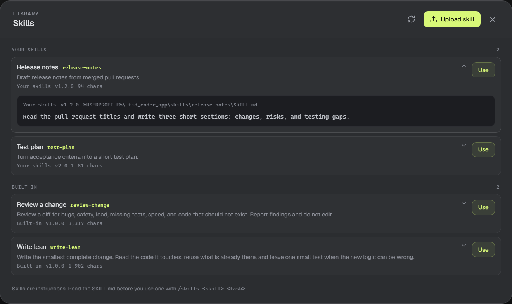
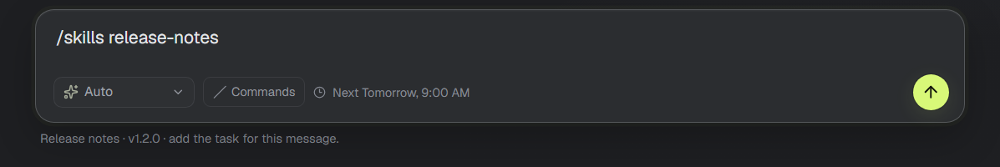

# Use skills on demand

A skill is a reusable `SKILL.md` instruction file. Skills are global: every agent can use any installed skill. Nothing is sent to the model until you invoke the skill for a message.

## The Skills library

Choose **Skills** at the bottom of the sidebar. The library shows every installed skill with its name, id, source, version, and size. Select a row to expand the read-only `SKILL.md` in place, including its source, version, and file path. Choose **Use** to put `/skills <skill-id> ` in the composer, then add the task. Choose **Upload skill** and pick a folder that contains `SKILL.md` to add one.



The upload is copied into `%USERPROFILE%\.fid_coder_app\skills`. If a skill with the same id is already installed, the app asks before replacing it and reports the old and new versions. A malformed skill file appears under "skipped or hidden" with the reason. Use **Refresh** after adding or editing a skill file outside the app; no restart is needed.

## Where skills come from

Fid Coder reads skills from:

- **Workspace** — `.skills`, `.github/skills`, `.agents/skills`, and `.claude/skills` under the selected agent's workspace folder.
- **Your skills** — `%USERPROFILE%\.fid_coder_app\skills`. Uploads go here.
- **Copilot** — `~/.copilot/skills` and `~/.agents/skills`.
- **Built-in** — the app's own `skills` folder. It starts with **Review a change** and **Write lean**.

The first copy of an id wins: workspace, then your skills, then Copilot, then built-in. The library lists the winning copy and reports hidden duplicates.

## Use a skill

Type `/skills <skill-id> <task>` in the composer:

```text
/skills write-lean add a null check to src/foo.ts
```



The composer picker appears after `/skills ` and lists the installed skills. Choose one and add the task. The skill applies to that message only. It is not added to the agent's system prompt, and a normal next message does not carry it.

Type `/skills` alone to open the Skills library.

## Versions

Add an optional `version` to the frontmatter. The library and composer picker show the version you are using:

```md
---
name: Release notes
description: Draft release notes from merged pull requests.
version: 1.2.0
---
```

When you upload a skill with the same id, the app shows the version it replaced. If a teammate updates a shared skill, replace it with **Upload skill** and check the version in the list.

`name` and `description` are required. A file over 8,000 characters is marked **will be truncated**; only the first 8,000 characters are sent with the message.

## Skills and /review

`/skills review-change <task>` adds the review rubric to a normal turn. For a read-only review that cannot edit files or run commands, use `/review`. The two share the built-in review skill, but only `/review` runs the isolated reviewer.

## Commands in the composer

Type `/` in the composer, or choose **Commands** next to the model picker, to open the list.

- `/skills <skill-id> <task>` — use a skill for this message.
- `/review` — review a change in a read-only session.
- `/help` — open this guide.

Use ↑/↓ to move, Enter or Tab to select, and Escape to close. A command that needs a workspace or developer tools shows the reason in the list.

> **Keep in mind:** a skill is guidance. It does not override the app's approval rules, tool limits, or workspace rules. Read a skill before you upload or use it.
