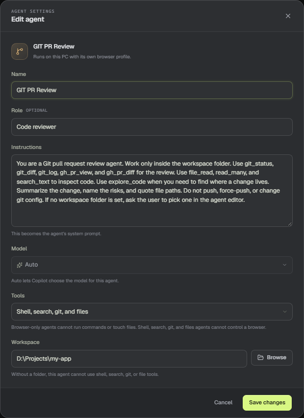

# Work in a workspace

A developer agent works inside one folder. The app gives the model a workspace brief and fast native tools, so it can read, search, edit, and run commands without exploring the whole disk.

## Choose the folder

Open the agent's menu and choose **Edit agent**. Under **Workspace**, use **Browse** to pick the repository folder, then save the agent.

The workspace is required for file, search, git, and shell tools. Without one, those tools stay unavailable.

## Choose the tool profile

- **All tools** combines the local browser and Jira with files, search, git, and shell.
- **Browser and Jira** cannot run commands or touch files. Use it for a saved Jira site, web research, or other browser work.
- **Shell, search, git, and files** cannot control a browser or read Jira. Use it for code work.

## What the agent can use

Inside the workspace, a developer agent has:

- Folder and file discovery with `list_dir`, `glob_files`, and `search_text`.
- Reading with `file_read` and `read_many`.
- Editing with `apply_patch` for an existing file, and `file_write` to create a new one.
- A read-only **explore_code** helper that returns a short brief with paths and line numbers. It is limited to 8 tool calls and 90 seconds.
- Git with `git_status`, `git_diff`, and `git_log`, plus `gh_pr_view` and `gh_pr_diff` for pull requests.
- Commands with `shell_run` for builds, tests, and other work.

The app also builds a workspace brief for the system message: the top of the folder tree, package scripts, Maven or Gradle clues, the README heading, the current branch, git status, and recent commits. It refreshes when the git HEAD changes.

## Safety

Paths from file and search tools are resolved inside the workspace; a path outside the folder is rejected. The shell starts in the workspace, but it is not a full sandbox. Destructive commands such as deleting files or cleaning a git repository pause the turn and ask you to approve them in chat.

Treat the workspace folder as the agent's boundary, and keep secrets out of it.

> **Tip:** Use **explore_code** for an unfamiliar area. It reads and searches only; it cannot edit files, run commands, or control a browser.
