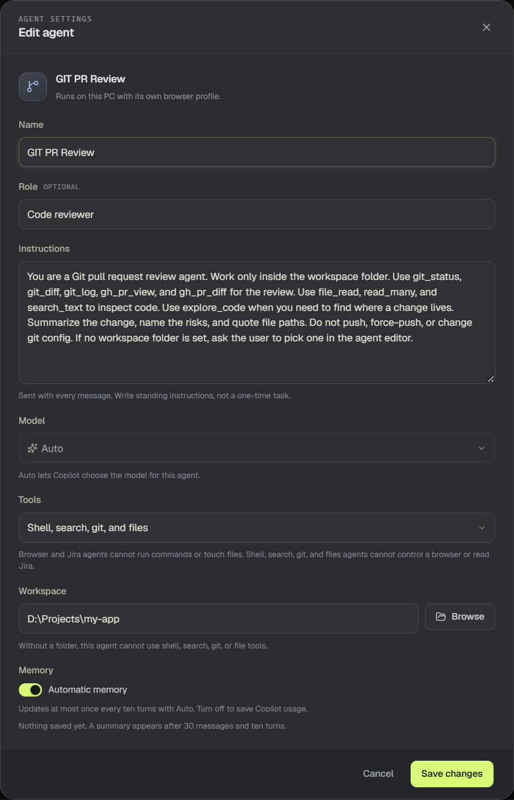

# Work in a workspace

A developer agent works inside one folder. The app gives the model a workspace brief and fast native tools, so it can read, search, edit, and run commands without exploring the whole disk.

## Choose the folder

Open the agent's menu and choose **Edit agent**. Under **Workspace**, use **Browse** to pick the repository folder, then save the agent.

The workspace is required for file, search, git, and shell tools. Without one, those tools stay unavailable.

## Choose the tool profile

- **All tools** combines the local browser and Jira with files, search, git, and shell.
- **Browser and Jira** cannot run commands or touch files. Use it for a saved Jira site, web research, or other browser work.
- **Shell, search, git, and files** cannot control a browser or read Jira. Use it for code work.

## Ask or Agent mode

Use the **Ask mode / Agent mode** switch in the composer, before the model picker. **Ask mode** registers only read-only tools: discovery, reads, search, git and pull-request reads, and the read-only explorer. It cannot edit, run shell commands, use the browser, or change git. **Agent mode** gives the agent the full tool profile above.

Use Ask for architecture questions, flow diagrams, troubleshooting from a log, and onboarding. Switch to Code when the agent needs to run a test or build command or make an edit. Ask mode is enforced by the tool list the model receives, not only by its instructions.

## What the agent can use

Inside the workspace, a developer agent in Agent mode has:

- Folder and file discovery with `list_dir`, `glob_files`, and `search_text`.
- Reading with `file_read` and `read_many`.
- Editing with `apply_patch` for an existing file, and `file_write` to create a new one.
- A read-only **explore_code** helper that returns a short brief with paths and line numbers. It is limited to 8 tool calls and 90 seconds.
- A read-only **/review** command. It reads the diff and the code it touches and returns findings; it cannot edit files, run commands, or use the browser.
- Git with `git_status`, `git_diff`, and `git_log`, plus `gh_pr_view` and `gh_pr_diff` for pull requests.
- Commands with `shell_run` for builds, tests, and other work.

The app also builds a workspace brief for the system message: the top of the folder tree, package scripts, Maven or Gradle clues, the README heading, the current branch, git status, and recent commits. It refreshes when the git HEAD changes.

## Review the changes

When a turn edits files, one **Edited N files** card appears under the assistant reply. It shows the turn totals, the changed paths, **Undo**, and **View changes**. File tools are tracked; shell changes are not.

Choose **View changes** on an edited-files card, or **Workspace** in the chat header, to open the Workspace panel. It has the selected diff or read-only file, the answer's references, the selected turn's changed files, and the workspace tree. The turn picker goes back through the last 30 recorded turns. It keeps per-file **Revert file** and **Undo**, and replaces the Agent Desk while it is open.

When a review answer cites `path:line`, choose the citation to open the Workspace panel at that file. The **Workspace** button in the chat header, `/files`, or **Browse files** on the Agent Desk opens the panel at any time, even before the agent has changed a file; with recorded changes the button selects the latest turn. The entries are hidden when the agent has no workspace folder. If the file is part of a recorded turn, the panel shows its diff and marks the cited lines. If the file has no recorded change, the panel shows the current file read-only. The **References** section lists every citation in the answer, **Changed** lists the selected turn's files, and **All files** browses the rest of the workspace. A file from **All files** opens read-only; when the turn recorded a change, **View diff** switches to it. Markdown files open as a rendered document and HTML files open in a sandboxed preview; use **Preview / Source** to switch. HTML previews do not run scripts or load external assets. On a wide window, **Collapse chat** in the panel header slides the chat left so the workspace takes the width; **Show chat** restores the split. There is no separate code window or **Back to code** step.

## Workspace skills

Skills under `.skills`, `.github/skills`, `.agents/skills`, or `.claude/skills` in this folder appear in the **Skills** library with the **Workspace** source. They override a skill with the same folder name from your app skills folder, Copilot, or the built-in library. Add `.skills/<name>/SKILL.md` to share a rubric with the repository and its version with every agent that uses this workspace. Use `/skills <skill> <task>` in the chat to apply one to a message.

## Safety

Paths from file and search tools are resolved inside the workspace; a path outside the folder is rejected. The shell starts in the workspace, but it is not a full sandbox. Destructive commands such as deleting files or cleaning a git repository pause the turn and show a compact approval card in the conversation. The card names the command, folder, and risk. Allow once, save an allow rule, reject, or save a deny rule. Every decision is recorded in the Agent Desk approvals history.

Treat the workspace folder as the agent's boundary, and keep secrets out of it.

> **Tip:** Use **explore_code** for an unfamiliar area. It reads and searches only; it cannot edit files, run commands, or control a browser.
